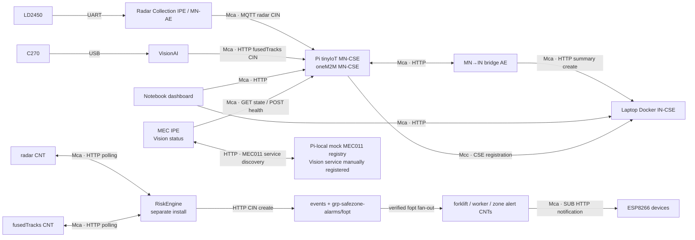

# Sejong_4IoT_OneM2M

**Heavy-equipment proximity hazard detection prototype**
oneM2M · ETSI MEC AIoT Hackathon · Team 4IoT

> Last updated: 2026-11-20 · [한국어](README.md)

> **Behavior confirmed in the demo (2026-11-20):** The Pi radar uploader creates CINs over MQTT, and the RiskEngine evaluates radar and Vision input through HTTP polling and writes to the alarm group. The video shows the distance stages, camera–radar confirmation of the same worker and the WARNING→DANGER raise for a crouching posture, a VisionAI stop, and UNKNOWN→model fork stop when the radar stops. The group write fanned out to the three alert CNTs, and the worker ESP's DANGER mode was confirmed. The Pi MN-CSE is registered with the laptop IN-CSE; event history is moved by a separate HTTP/Mca bridge and viewed on the laptop dashboard. Automatic boot-time registration of Vision and long-term reliability were not checked. DHCP reservation was not configured at the 20 November check. The SG90 moves the model's fork and does not control a real forklift's drive motor. See the detailed [architecture](docs/architecture.md) and [deployment record](docs/deployment.md).

> **Pi check after recording:** The RiskEngine Origin is `Criskengine`, and its inputs and writes use HTTP polling/write. We attached `macp` to the operational group and limited the `Criskengine` permission on the three alert CNTs to CREATE. Writes to events and the three alert CNTs succeeded, but this ACP retest did not check ESP notification receipt or device output. The MEC IPE discovered the address of the manually registered Vision service in the MEC011 registry and read the latest oneM2M data. When VisionAI was run briefly, the data status changed `INACTIVE → ACTIVE`; VisionAI was stopped again after the test. The registration state `ACTIVE` and the data-freshness state are separate.

---

## 1. Project overview

### 1.1 Background

Forklifts and cranes have wide blind spots because of their structure, so workers are repeatedly struck or caught while the vehicle reverses or turns. Existing rear cameras and warning lights only assist the driver; they do not warn the worker directly, and the equipment does not stop by itself. UWB/BLE tag systems require workers to wear a device, so a forgotten tag or a dead battery leaves a protection gap.

### 1.2 Goals — not every function below has been confirmed in the field

| Goal | Description |
|---|---|
| Tagless detection | Detect workers without wearable devices using a 24 GHz mmWave radar (HLK-LD2450) |
| Predictive judgment | Implement risk judgment based on distance and relative motion, aiming at equipment slow-down/stop and worker alerts |
| Standard interoperability | Manage all data as oneM2M standard resources so monitoring, analysis and third-party equipment can connect |


---

## 2. Confirmed system configuration

The actual Pi execution flow and test boundaries are summarized in the [call-flow figure and integration record](docs/architecture.md). tinyIoT is the Pi's **oneM2M MN-CSE**. The operational MEC IPE discovers the Vision data service by service name and only reads addresses inside the allowed oneM2M CSE. Separating the service name from its address prepares a path for scaling to more edge devices; currently one service is registered manually and has been checked. Because MEP application placement and management have not been confirmed, the MN-CSE, VisionAI and the IPE/adapter are not classified as MEC Apps.



Only the radar uploader creates radar CINs over MQTT on the Pi. The RiskEngine polls the radar and configured Vision CINs over HTTP to judge risk, and writes to `events` and the alarm group over HTTP. VisionAI processes the USB camera image and writes `fusedTracks` over HTTP. The SUB notifications to both ESPs are also HTTP. The MN is registered with the laptop IN over Mcc, and event-history transfer is a separate path in which a bridge AE sends Mca/HTTP requests to both CSEs. The laptop dashboard reads the MN's current state and the IN's history. The temporary Pi dashboard is excluded from this diagram.

### Why we chose tinyIoT as the oneM2M server

The initial plan used Mobius, but we switched to tinyIoT. tinyIoT is a lightweight oneM2M CSE written in C, so it runs comfortably on a Raspberry Pi, and it is included as an MN-CSE in the ETSI MEC sandbox, which fits a competition that covers both oneM2M and ETSI MEC.

---

## 3. How it works

### 3.1 Detection and risk judgment

The current distance is computed from the LD2450's 2D target coordinates, and the relative velocity, time of closest approach `t_cpa` and closest distance `d_cpa` are estimated from consecutive coordinates and timestamps. `t_cpa` is not the time of first entering the danger radius; it is the time of closest approach assuming a constant relative velocity. Missing or stale input is distinguished as `UNKNOWN`.

The current Pi demo settings are warning 2.5 m, danger 1.5 m, input freshness 5 s, and a 5 s upper bound on the target-association interval. These are team-selected demo values, not optimal tracking settings, industrial safety standards or validated braking distances. A separate 18 November model test used 1.0 m / 0.5 m, so settings from different recording dates are not mixed. Sensor coordinate frame, mounting offset, actual target persistence and reception delay need further validation.

### 3.2 Alerts and device control

The operational Pi RiskEngine runs from a separate installed snapshot. With `RADAR_LOCAL_DECISION=0`, the engine judges risk and writes to `events` and the alarm group. We confirmed that the group `/fopt` fan-out records DANGER in the three alert CNTs and that the worker ESP enters risk mode. The demo also showed the SG90 fork servo stopping the model fork. The camera can raise risk but never lower it; when the radar input expires, UNKNOWN is recorded and the model fork stops. This is not real forklift drive-motor control or a safety interlock.

UNKNOWN after radar-input expiry and the SG90 model fork stop were demonstrated. Independent stopping when the engine, CSE or Wi-Fi itself fails, group recovery after boot, all output combinations and long-term reliability were not verified.

### 3.3 Vision and the IN-CSE

In the demo video, VisionAI processed the C270 input, linked the same person as the radar as confirmed, and a crouching-posture cue raised WARNING to DANGER. Stopping the camera AI and radar-input expiry were each demonstrated. The laptop dashboard shows the MN's current state and the history the bridge stored in the IN. VisionAI ran during the demo; automatic start at boot is a separate item to check.

## 4. oneM2M resource design

### 4.1 Resource tree

The following resource tree summarizes the paths and group configuration confirmed by querying the Pi. The standalone test server and the operational Pi use different settings and databases.

```text
TinyIoT-MN
├─ grp-safezone-alarms       [GRP] 3 alert CNTs: forklift / worker / zone
├─ AE-forklift01             [AE]
│  ├─ radar                  [CNT] LD2450 frame CIN
│  └─ alert                  [CNT] forklift SUB uses HTTP /notify
├─ AE-worker01               [AE] lbl type:worker-alarm
│  └─ alert                  [CNT] worker SUB nu=Cworker01 → AE poa
├─ AE-riskengine             [AE]
│  └─ events                 [CNT] RiskEngine event history
├─ AE-VisionAI               [AE]
│  └─ fusedTracks            [CNT] camera/radar Vision output
├─ AE-zonealarm01            [AE]
│  └─ alert                  [CNT] group member; no physical zone device
└─ AE-mecIPE                 [AE]
   └─ status                 [CNT] Vision service-health state
```

After the worker AE re-registered, the new alert CNT RI was linked into the alarm group's `mid`. A later ACP change set `Criskengine` CREATE permission on the operational group `macp` and the three alert CNTs, and `cnm=3` was confirmed. In the recorded demo we observed the worker ESP's DANGER mode after the `/fopt` fan-out; the post-recording ACP retest only confirmed the records in the three CNTs. Exact ACP/SUB URIs and per-server CSE naming are distinguished in the [deployment record](docs/deployment.md).

Main resource types: CSEBase (ty 5) is the server root, ACP (1) is an access policy, AE (2) an application, CNT (3) a data container, CIN (4) an individual data item, GRP (9) a group, and SUB (23) a change-notification setting.

Resources carry `lbl` (labels) so they can be found by search without knowing their names (`?fu=1&lbl=safezone:alarm`). Alarm devices are bound into the group `grp-safezone-alarms` by this search, and the alert writer writes once to the group's fanOutPoint (`/fopt`). To create it, run `python3 onem2m/alarm_group.py`; see [시연방법.md section G](시연방법.md) for details.

### 4.2 Subscription flow

| Segment | Current status |
|---|---|
| radar CIN → RiskEngine | Pi uploader MQTT CIN creation and RiskEngine HTTP polling confirmed |
| RiskEngine → events / alert group | The separate Pi install writes events and `/fopt` over HTTP. DANGER confirmed in the three alert CNTs |
| alert SUB → ESP8266 | Worker `nu=Cworker01` → AE poa path and worker risk mode confirmed. The forklift `/notify` path's model behavior was reported in the 11/15 and 11/18 tests |
| events → IN-CSE | MN→IN bridge HTTP polling/write and laptop Docker IN records confirmed |

The oneM2M MQTT binding, HTTP requests and the oneM2M SUB resource are features on different layers. Currently MQTT covers radar CIN creation, while RiskEngine and Vision write/read, ESP notifications and the MN→IN bridge use HTTP. The operational Pi MEC IPE discovered the manually registered Vision service through MEC011 and queried the freshness of the actual oneM2M CIN. Automatic service registration and address updates across multiple edge devices, automatic selection of the appropriate service, and remote CSE connection are next steps.

### 4.3 Data formats (con)

| Input/output | Current code and test assumptions | To check |
|---|---|---|
| radar | `x`, `y`: mm; `v`: cm/s. Actual CIN examples reported with `slot` | Units, signs, timestamp, empty-frame period and slot persistence |
| fusedTracks | `x`, `y`, `dist_m`: m; `ttc_s`: s | Origin, axis directions, target ID, time, validity period |
| events | RiskEngine decision history; `status`, `level`, `reason`, etc. | Creation, retrieval and transfer to IN |
| alert | Status message for devices | Fields, writer and agreed UNKNOWN handling |

A CIN's `con` may be a JSON string. Vision's `ttc_s` and the RiskEngine's `t_cpa` are different calculations. The sensor timestamp and the engine's monotonic reception time are not mixed.

For example, one radar target can use the form `{"ts": 1760360000.12, "targets": [{"slot": 0, "x": 373, "y": 366, "v": -8}]}`. This is a format example and does not guarantee slot tracking continuity or actual empty-frame transmission.

### 4.4 Communication bindings

| Segment | Current confirmation and goal |
|---|---|
| LD2450 → Radar Collection IPE | UART, Pi radar uploader |
| Radar IPE → MN-CSE | MQTT oneM2M radar CIN create |
| VisionAI → MN-CSE | C270 USB input; VisionAI HTTP fusedTracks CIN create |
| MN-CSE ↔ RiskEngine | HTTP polling for radar/Vision; HTTP create for events and alert-group `/fopt` |
| alert CNT → ESP | HTTP SUB notification over Mca; worker DANGER mode verified; forklift servo/buzzer in dated model tests |
| MN-CSE → IN-CSE | MN registers with laptop IN over Mcc; a separate bridge AE copies event summaries over HTTP/Mca |
| MEC011 / Vision status | Operational IPE discovered the manually registered `fusedTracks` service and read actual oneM2M data; status changed INACTIVE→ACTIVE during a brief VisionAI run |

## 5. Repository structure

```text
Sejong_4IoT_OneM2M/
├─ README.md                    Project introduction (Korean); README.en.md (English)
├─ 시연방법.md                  Demo procedure (full pipeline on one Pi, services, engine alert mode) (Korean)
├─ docs/
│  ├─ architecture.md           System configuration, resource tree, call flow
│  ├─ data-format.md            Data format per container (team-agreed document)
│  ├─ cse-naming.md             CSE and AE naming rules
│  └─ runbook.md                tinyIoT operation, MEC liveness IPE
├─ radar/                       Radar: LD2450 uploader (radar_node.py), simulated radar (sim_rader.py)
├─ engine/                      Risk engine: distance and CPA, camera fusion rules, SAFE release delay
├─ vision/                      VisionAI: camera person/pose → floor coordinates → fusion with radar → fusedTracks (AGPL-3.0)
├─ onem2m/                      MN→IN bridge, MEC liveness IPE, alarm device group (lbl+grp), latency measurement, subscription and CSE scripts
├─ dashboard/                   Monitoring dashboard (MN live, IN history, VisionAI status)
├─ esp8266/                     Forklift node (alert_node), worker node (worker_node), MQTT version
├─ systemd/                     Pi services (radar, engine, bridge, MEC IPE; the local dashboard unit is temporary)
├─ tools/preflight.py           Pre-demo check (services, data, alert writers, dead subscriptions)
├─ experiments/mec011-host-a/   MEC 011 service registration/discovery experiment, oneM2M↔MEC adapter AE
└─ camera/                      (Early version) webcam motion detection
```

`secrets.h`, which contains Wi-Fi credentials, is excluded by `.gitignore`; only the template `secrets.example.h` is committed.

---

## 6. Hardware and development environment

### 6.1 Equipment

| Equipment | Qty | Purpose |
|---|---|---|
| HLK-LD2450 24 GHz radar | 1 | Tagless worker detection input via Pi UART |
| Raspberry Pi 4B | 1 | tinyIoT MN-CSE, radar uploader, RiskEngine, VisionAI, bridge, MEC IPE |
| Logitech C270 | 1 | USB camera; VisionAI processes the image |
| NodeMCU ESP8266 1.0 + HW-389 | 1 | Scale forklift alarm node |
| SG90 servo | 1 | Moves and stops the model fork. Not a drive motor |
| Active buzzer TMB12A05 | 2 | Forklift and worker alarm sound |
| NodeMCU ESP8266 v3 (LoLin) | 1 | Worker tag with buzzer and LED window |
| 9 V battery | 1 | Power for the forklift alarm node inside the model |
| 5 V, 3 A supply for the Pi | 1 | Raspberry Pi power |
| USB power bank | 1 | Used in the phone-hotspot outdoor setup test |
| Laptop, phone hotspot | 1 each | Docker IN-CSE, demo dashboard, network, SSH, firmware upload |
| 3D-printed parts | As needed | Scale forklift model, radar mount, worker tag case |

### 6.2 Software

| Category | Details |
|---|---|
| MEC OS | Raspberry Pi OS Lite 64-bit (Debian Trixie) |
| oneM2M CSE | tinyIoT MN-CSE and IN-CSE (C, SQLite database) |
| Radar, RiskEngine, VisionAI, bridge, dashboard, IPE | Python 3 |
| VisionAI | Ultralytics YOLO11n-pose (NCNN), OpenCV |
| MQTT broker | Eclipse Mosquitto (Pi, oneM2M MQTT binding) |
| IN-CSE | Docker container |
| ESP8266 | Arduino IDE, esp8266 board package 3.1.2, ArduinoJson 7 |
| Development tools | VS Code Remote-SSH, Git/GitHub |
| 3D modeling | OpenSCAD |

### 6.3 Wiring

Diagrams: [radar node](docs/Schematics%20and%20circuit%20diagrams/1_radar_pi_uart.png) · [forklift alarm node](docs/Schematics%20and%20circuit%20diagrams/2_forklift_alarm_node.png) · [worker alarm tag](docs/Schematics%20and%20circuit%20diagrams/3_worker_alarm_tag.png)

**① Radar node: LD2450 → Raspberry Pi 4 (UART)**

| LD2450 | Raspberry Pi 4B |
|---|---|
| 5V | Pin 2 (5V) |
| GND | Pin 6 (GND) |
| TX | Pin 10 (GPIO15, RXD) |
| RX | Pin 8 (GPIO14, TXD) |

The link is 256000 bps, 8N1, 3.3 V level. In `raspi-config`, turn the serial login shell off and the serial hardware on. The C270 connects to the Pi over USB. The SG90 in the forklift model moves the fork; it is not the vehicle's drive motor.

**② Forklift alarm node: NodeMCU 1.0 + HW-389 base board**

| Part | Connection | Note |
|---|---|---|
| SG90 signal (orange) | D5 (GPIO14) | `Servo.attach(14, 500, 2400)` |
| SG90 + (red) | Base board power header 5V | Do not use the V pin (3.3V) of the signal row |
| SG90 − (brown) | GND | |
| Buzzer + (long leg) | D6 (GPIO12) | Active buzzer TMB12A05 |
| Buzzer − (short leg) | GND | |
| 9V battery | Base board DC jack | Standalone operation |

It receives `AE-forklift01/alert` through tinyIoT subscription notifications (HTTP `/notify`). safe: fork moves back and forth / warn: moving + slow beep / danger and unknown: fork stops + alarm. The built-in LED (GPIO2) is on while alarmed.

**③ Worker alarm tag: NodeMCU v3 (LoLin)**

| Part | Connection |
|---|---|
| Buzzer + (long leg) | D6 (GPIO12) |
| Buzzer − (short leg) | GND |
| USB power bank | micro-USB |

On boot it registers itself with tinyIoT as `AE-worker01` (`lbl type:worker-alarm`). warn: slow beep, danger: fast beep; the built-in LED blinks with the buzzer.

The initial target wiring (the ESP8266 reading the radar directly and an Arduino controlling a motor driver) was not adopted. The radar is read through the Pi UART, and the alarm devices receive oneM2M subscription notifications so the ESP8266 controls the servo and buzzer directly.

---

## 7. License

Following the competition rules, source code is released under the Apache License 2.0 and non-code material under CC BY 4.0. However, VisionAI uses Ultralytics YOLO11, which is AGPL-3.0, so only `vision/` is AGPL-3.0.

| Part | License | Reason |
|---|---|---|
| Code in `engine/`, `radar/`, `onem2m/`, `esp8266/`, `camera/` | Apache 2.0 ([LICENSE](LICENSE)) | Competition source-code rule |
| `vision/` (VisionAI) | AGPL-3.0 ([vision/LICENSE](vision/LICENSE)) | Uses Ultralytics YOLO11 (AGPL-3.0) |
| Documents (`docs/`, README), presentation material, demo video | CC BY 4.0 | Competition non-code material rule |

Each part is a separately running program and exchanges data only through the oneM2M CSE (HTTP/MQTT). They do not link each other's code, so the AGPL-3.0 terms of `vision/` do not apply to the Apache 2.0 parts. The competition's license mentor reviewed this separation on 2026-11-13 and confirmed it is fine for the competition. External library licenses for VisionAI are listed in [vision/README.md](vision/README.md#license).
