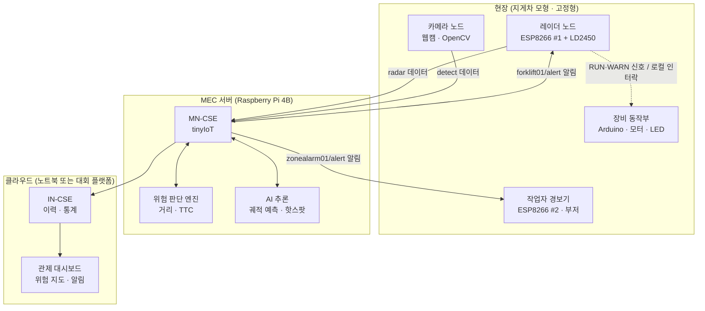
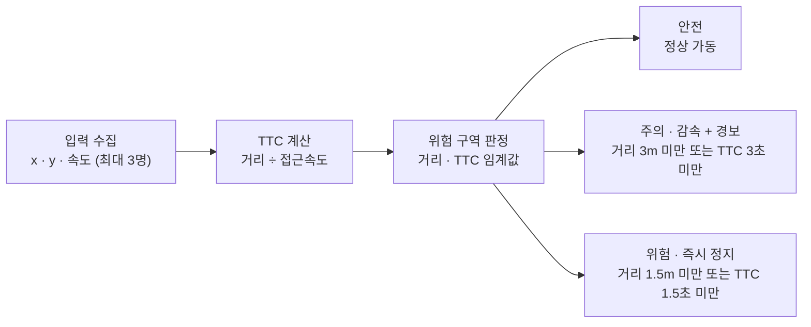

# Sejong_4IoT_OneM2M

**중장비 근접 위험 감지 및 자동 정지 시스템**
oneM2M · ETSI MEC 기반 AIoT 해커톤 · 4IoT 팀

> 최종 수정: 2026-10-28

---

## 1. 프로젝트 개요

### 1.1 배경

지게차와 크레인은 차체 구조상 사각지대가 넓어, 후진이나 선회 중 작업자와 부딪히거나 끼이는 사고가 반복된다. 기존 후방카메라와 경광등은 운전자를 보조할 뿐 작업자에게 직접 경고하지 않고, 장비가 스스로 멈추지도 않는다. UWB·BLE 태그 방식은 작업자가 장비를 착용해야 해서, 미착용이나 배터리 방전 시 보호 공백이 생긴다.

### 1.2 목표

| 목표 | 내용 |
|---|---|
| 무태그 감지 | 24GHz mmWave 레이더(HLK-LD2450)로 작업자를 착용 장비 없이 감지한다 |
| 예측형 판단 | 충돌까지 남은 시간(TTC)으로 위험도를 판정해 장비 자동 감속·정지와 작업자 경보를 수행한다 |
| 표준 상호운용성 | 모든 데이터를 oneM2M 표준 리소스로 관리해 관제·분석과 타사 장비 연동이 가능하게 한다 |


---

## 2. 시스템 구성



| 계층 | 구성 | 역할 |
|---|---|---|
| 현장 | 레이더 노드 (ESP8266 #1 + LD2450) | 표적 좌표·속도 수집, 로컬 인터락 판정, CSE 업로드 |
| 현장 | 장비 동작부 (Arduino + 모터 + LED) | 장비 동력 표현, 상태별 감속·정지·표시 |
| 현장 | 작업자 경보기 (ESP8266 #2 + 부저) | 작업 구역 내 작업자 경보 |
| 현장 | 카메라 노드 (웹캠) | 움직임·사람 검출로 레이더 감지 보완 |
| MEC | Raspberry Pi 4B | MN-CSE(tinyIoT), 위험 판단 엔진, AI 추론 |
| 클라우드 | 노트북 또는 대회 제공 플랫폼 | IN-CSE, 이력 저장, 관제 대시보드 |

대회에서 MEC 플랫폼을 제공하면 위험 판단 엔진과 AI를 MEC 애플리케이션으로 배포한다.

### oneM2M 서버로 tinyIoT를 선택한 이유

초기 기획은 Mobius였으나 tinyIoT로 변경했다. tinyIoT는 C로 작성된 경량 oneM2M CSE라 라즈베리파이에서 부담 없이 동작하고, ETSI MEC 샌드박스에도 MN-CSE로 포함되어 있어 oneM2M과 ETSI MEC를 함께 다루는 대회 조건에 맞는다.

---

## 3. 동작 원리

### 3.1 감지

LD2450을 지게차 모형 후방(후진 사각지대 방향)에 고정한다. 최대 3명을 동시에 추적하며 표적별 x·y 좌표(mm)와 속도(cm/s)를 출력한다(탐지 약 6m, 시야각 ±60°).

### 3.2 위험 판단



TTC는 접근 중인 표적에 대해서만 계산한다. 레이더 노드는 거리 1m 미만을 감지하면 네트워크를 거치지 않고 바로 정지 신호를 낸다(로컬 인터락). 임계값은 초기값이며 시험 후 조정한다.

### 3.3 상태별 동작

| 상태 | 모터 | LED | 작업자 경보기 |
|---|---|---|---|
| 안전 | 정상 회전 | 초록 | 없음 |
| 주의 | 감속 (PWM 50%) | 노랑 점멸 | 부저 단속음 |
| 위험 | 정지 | 빨강 | 부저 연속음 |
| 복귀 | 안전 상태 3초 유지 후 재가동 | 초록 | 없음 |

### 3.4 3중 경보 계층

| 계층 | 위치 | 판단 기준 | 특징 |
|---|---|---|---|
| 1차 | 레이더 노드 | 거리 | 네트워크와 무관, 지연 최소 |
| 2차 | MEC (라즈베리파이) | TTC · 다중 표적 · AI 예측 | 구독 알림으로 동작부·경보기 제어 |
| 3차 | 클라우드 IN-CSE | 누적 이력 | 아차사고 통계, 핫스팟 분석 |

### 3.5 AI 적용

궤적 예측은 표적 이력으로 1~2초 뒤 위치를 예측하고 그 위치 기준으로 TTC를 보정한다. 핫스팟 분석은 누적된 위험 이벤트 좌표를 군집화해 상습 위험 구역을 찾아 대시보드에 표시한다.

---

## 4. oneM2M 리소스 설계

### 4.1 리소스 트리

```text
TinyIoT                         [CSEBase]  MN-CSE (라즈베리파이)
├─ defaultACP                   [ACP]      기본 접근 권한 정책 (자동 생성)
├─ AE-forklift01                [AE]       지게차      Origin: Cforklift01
│   ├─ radar                    [CNT]      표적 x·y·속도 (최대 3명), mni 100
│   └─ alert                    [CNT]      위험 상태 → 감속·정지, mni 20
│       └─ sub-alert-node       [SUB]      새 데이터 → 레이더 노드(ESP8266)에 알림
├─ AE-zonealarm01               [AE]       구역 경보기  Origin: Czonealarm01
│   └─ alert                    [CNT]      부저 동작, mni 20
├─ AE-riskengine                [AE]       위험 판단 엔진  Origin: Criskengine
│   └─ events                   [CNT]      위험 이벤트 (→ IN-CSE), mni 100
└─ AE-camera01                  [AE]       카메라      Origin: Ccamera01
    └─ detect                   [CNT]      움직임·사람 검출 결과, mni 100
```

| ty | 리소스 | 역할 |
|---|---|---|
| 5 | CSEBase | 서버 최상위 |
| 1 | ACP | 접근 권한 정책 |
| 2 | AE | 등록된 앱·장치 |
| 3 | CNT | 데이터를 담는 컨테이너 |
| 4 | CIN | 컨테이너에 쌓이는 데이터 한 건 |
| 23 | SUB | 구독 (변경 시 알림) |

`mni`(최대 인스턴스 수)를 설정해 오래된 데이터는 자동 삭제되고, 레이더는 표적이 있을 때만 업로드해 데이터가 과도하게 쌓이지 않게 한다.

### 4.2 구독 흐름

| 구독 대상 | 알림 받는 쪽 | 용도 | 상태 |
|---|---|---|---|
| AE-forklift01/radar | 위험 판단 엔진 | 레이더 데이터로 위험 판정 | 예정 |
| AE-forklift01/alert | 레이더 노드 (ESP8266) | 감속·정지 신호 출력 | 구현 |
| AE-zonealarm01/alert | 작업자 경보기 (ESP8266 #2) | 부저 동작 | 예정 |

### 4.3 데이터 형식 (con)

| 컨테이너 | 작성 | 형식 예시 |
|---|---|---|
| AE-forklift01/radar | 레이더 | `{"ts": 1760360000.12, "targets": [{"x": 373, "y": 366, "v": -8}]}` |
| AE-camera01/detect | 카메라 | `{"ts": 1760360000.15, "objects": [{"cls": "motion", "bbox": [120, 80, 60, 150]}]}` |
| AE-forklift01/alert | 엔진 | `{"level": "danger", "dist": 1200, "ttc": 1.2}` |
| AE-riskengine/events | 엔진 | `{"ts": 1760360000.12, "level": "danger", "target": 0}` |

`ts`는 Unix 시간(초, 소수점 포함), 거리는 mm, 속도는 cm/s, `level`은 `safe`, `warn`, `danger` 중 하나다. 레이더와 카메라 데이터를 시간으로 짝지을 수 있도록 모든 장치는 인터넷 시간 동기화를 켠다.

### 4.4 통신 바인딩

| 구간 | 방식 | 비고 |
|---|---|---|
| 디바이스 ↔ CSE | 현재 HTTP, 이후 MQTT | 설계상 MQTT 바인딩(브로커: Mosquitto). 우선 HTTP로 구독·알림 흐름을 완성한 뒤 전환 |
| CSE ↔ CSE | HTTP | MN-CSE(라즈베리파이) ↔ IN-CSE(클라우드) |

---

## 5. 저장소 구조

```text
Sejong_4IoT_OneM2M/
├─ README.md                    프로젝트 소개 (이 문서)
├─ .gitignore
├─ docs/
│  ├─ architecture.md           시스템 구성, 리소스 트리 상세
│  ├─ data-format.md            컨테이너별 데이터 형식 (팀 합의 문서)
│  └─ runbook.md                작업 재개 절차 (핫스팟 연결 → tinyIoT 실행)
├─ onem2m/
│  ├─ setup_onem2m.sh           AE·CNT 일괄 생성
│  ├─ sub_alert_node.sh         ESP8266 알림 구독 생성
│  └─ demo.sh                   시연용 조회·기록 스크립트
├─ radar/                       레이더 파트
│  ├─ README.md
│  ├─ ld2450.py                 LD2450 프레임 파싱 테스트
│  ├─ proximity.py              (초기 버전) 근접 경고 → ESP8266 직접 호출
│  └─ radar_node.py             레이더 데이터·위험 상태를 tinyIoT에 업로드
├─ camera/                      카메라 파트
│  ├─ README.md
│  └─ motion_detect.py          웹캠 모션 감지 → AE-camera01/detect
├─ engine/                      위험 판단 엔진 (TTC, 2단계 판정)
│  └─ README.md
└─ esp8266/
   ├─ led_server/               (초기 버전) /on·/off 웹서버
   │  ├─ led_server.ino
   │  └─ secrets.example.h
   └─ alert_node/               tinyIoT 구독 알림 수신 → 출력 제어
      ├─ alert_node.ino
      └─ secrets.example.h
```

Wi-Fi 정보가 들어가는 `secrets.h`는 `.gitignore`로 제외하고, 양식인 `secrets.example.h`만 올린다.

---

## 6. 하드웨어 및 개발 환경

### 6.1 장비

| 장비 | 수량 | 용도 |
|---|---|---|
| HLK-LD2450 24GHz 레이더 | 1 | 작업자 무태그 감지 |
| ESP8266 (NodeMCU) | 2 | #1 레이더 노드, #2 작업자 경보기 |
| Arduino | 1 | 장비 동작부 제어 (모터·LED·부저) |
| Raspberry Pi 4B | 1 | MEC 서버 (tinyIoT, 엔진, AI) |
| 모터 + 모터 드라이버 (L298N/L9110S) | 1 | 장비 동력 표현, 속도·방향 제어 |
| LED (R/Y/G) + 220Ω 저항 | 각 1 | 상태 표시 |
| 부저 | 2 | 동작부, 경보기 (구매 필요) |
| 10kΩ 저항 | 1 | RUN 신호 풀다운 (Fail-safe) |
| 웹캠 | 1 | 카메라 노드 |
| 3D 프린터 | 1 | 지게차 모형, 레이더 마운트, 케이스 |
| 노트북 | 1 | IN-CSE, 대시보드 |

### 6.2 소프트웨어

| 구분 | 내용 |
|---|---|
| MEC OS | Raspberry Pi OS Lite 64-bit (Debian Trixie) |
| oneM2M CSE | tinyIoT (C, DB는 SQLite) |
| 레이더·엔진 | Python 3, pyserial |
| ESP8266 | Arduino IDE, esp8266 보드 패키지, ArduinoJson |
| 카메라 | Python 3, OpenCV |
| 개발 도구 | VS Code Remote-SSH, Git/GitHub |

### 6.3 배선

**현재 프로토타입 (LD2450 → 라즈베리파이 UART)**

| LD2450 | Raspberry Pi 4B |
|---|---|
| 5V | 핀 2 (5V) |
| GND | 핀 6 |
| TX | 핀 10 (GPIO15, RXD) |
| RX | 핀 8 (GPIO14, TXD) |

통신 규격은 256000bps, 8N1, 3.3V 레벨이다.

**최종 구성 (LD2450 → ESP8266 #1 → Arduino)**

| 연결 | 핀 | 비고 |
|---|---|---|
| LD2450 5V / GND | ESP8266 #1 VIN / GND | |
| LD2450 TX | ESP8266 #1 D7 (GPIO13) | `Serial.swap()` 후 하드웨어 RX |
| LD2450 RX | 미연결 | GPIO15 부팅 문제 회피 |
| ESP8266 #1 D5 | Arduino D2 | RUN 신호, 10kΩ 풀다운 → 선이 끊기면 정지 |
| ESP8266 #1 D6 | Arduino D3 | WARN 신호 |
| ESP8266 #1 GND | Arduino GND | 공통 접지 필수 |
| Arduino D5 / D7 / D8 | 모터 드라이버 ENA / IN1 / IN2 | D5 PWM으로 감속 |
| Arduino D9 | 부저 | |
| Arduino D10 / D11 / D12 | LED R / Y / G | 220Ω 직렬 |

ESP8266의 3.3V 출력은 5V Arduino 입력에서 대부분 HIGH로 인식된다. 불안정하면 레벨시프터를 추가한다.

---
