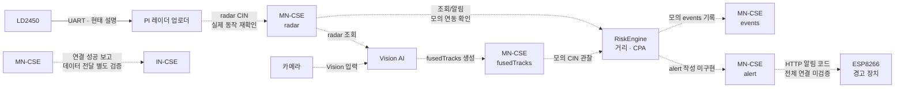

# Sejong_4IoT_OneM2M

**중장비 근접 위험 감지 및 자동 정지 시스템**
oneM2M · ETSI MEC 기반 AIoT 해커톤 · 4IoT 팀

> 최종 수정: 2026-10-28

---

## 1. 프로젝트 개요

### 1.1 배경

지게차와 크레인은 차체 구조상 사각지대가 넓어, 후진이나 선회 중 작업자와 부딪히거나 끼이는 사고가 반복된다. 기존 후방카메라와 경광등은 운전자를 보조할 뿐 작업자에게 직접 경고하지 않고, 장비가 스스로 멈추지도 않는다. UWB·BLE 태그 방식은 작업자가 장비를 착용해야 해서, 미착용이나 배터리 방전 시 보호 공백이 생긴다.

### 1.2 목표

| 목표 | 내용 |
|---|---|
| 무태그 감지 | 24GHz mmWave 레이더(HLK-LD2450)로 작업자를 착용 장비 없이 감지한다 |
| 예측형 판단 | 거리와 상대운동 기반 위험 판단을 구현하고, 장비 감속·정지와 작업자 경보를 목표로 한다 |
| 표준 상호운용성 | 모든 데이터를 oneM2M 표준 리소스로 관리해 관제·분석과 타사 장비 연동이 가능하게 한다 |


---

## 2. 시스템 구성

> **현재 프로토타입과 목표를 구분한다.** 2026-11-12 기준 현태의 설명은 LD2450 → Raspberry Pi UART 직접 연결이다. GitHub 코드와 별도 모의 시험이 존재하지만 실제 레이더·Vision·경보기의 전체 통합은 미검증이다. 서버별 이름·ID도 실제 조회값과 팀 제안을 구분한다. 자세한 내용은 [아키텍처와 통합 상태](docs/architecture.md)를 참고한다.

### 현재 프로토타입



점선은 코드·모의 시험 또는 향후 연결을 나타내며 실제 장비의 종단 간 성공을 뜻하지 않는다. 현재 ESP8266은 현태 설명에 따르면 LD2450에 직접 연결되지 않고 tinyIoT HTTP 알림을 받는다.

**통신 목표:** oneM2M MQTT Binding과 SUB/notification을 사용한다. 독립 시험 서버에서 모의 radar MQTT 발행 → SUB 알림 → RiskEngine → MQTT events 기록을 확인했다. 현재 GitHub의 기존 RiskEngine 기본 통신은 HTTP이며 MQTT 엔진은 별도 작업본이다. 실제 장치 및 최종 서버 적용 여부는 별도로 확인한다.

### oneM2M 서버로 tinyIoT를 선택한 이유

초기 기획은 Mobius였으나 tinyIoT로 변경했다. tinyIoT는 C로 작성된 경량 oneM2M CSE라 라즈베리파이에서 부담 없이 동작하고, ETSI MEC 샌드박스에도 MN-CSE로 포함되어 있어 oneM2M과 ETSI MEC를 함께 다루는 대회 조건에 맞는다.

---

## 3. 동작 원리

### 3.1 감지와 위험 판단

LD2450의 2D 표적 좌표로 현재 거리를 계산하고, 연속 좌표와 시간으로 상대속도 및 최근접 시점 `t_cpa`, 최근접 거리 `d_cpa`를 추정한다. `t_cpa`는 위험 반경에 처음 진입하는 시각이 아니라 일정한 상대속도를 가정한 최근접 시각이다. 입력 누락·오래된 데이터는 `UNKNOWN`으로 구분한다.

현재 거리 기준 warning 3m, danger 1.5m 및 CPA 기준은 **시험용 가설**이다. 실제 산업안전 기준이나 검증된 제동 거리가 아니다. 센서 좌표계 회전, 설치 오프셋, 차체 크기, 실제 표적 슬롯 유지와 수신 지연은 추가 검증이 필요하다.

### 3.2 경보와 장치 제어

현재 GitHub 엔진은 위험 상태를 `events`에 기록하는 코드가 있으며 `alert` 작성과 실제 장치 감속·정지의 전체 연동은 미검증이다. Pi에서 확인된 `LOCAL_DECISION`은 임시 거리 판단으로 alert CIN을 쓰는 별도 코드다. RiskEngine으로 전환할 때 작성 주체가 충돌하지 않도록 조정해야 한다.

네트워크 단절 시 독립적으로 모터를 정지시키는 로컬 인터락, `UNKNOWN` 시 장치 동작 및 재가동은 **목표·미확정**이다. LED 점등, 부저, 실제 모터 제어와 각각의 실패 동작을 따로 확인한다.

### 3.3 Vision과 IN-CSE

Vision AI는 카메라 정보와 레이더를 융합해 `fusedTracks`를 발행하는 코드가 있다. RiskEngine의 Vision 입력 관찰은 별도 작업본·모의 시험 단계이며 Vision 조언을 최종 위험 판단에 반영하는 규칙은 미정이다. Pi MN–노트북 IN의 연결 성공은 보고됐으나, 상위 등록과 `events` 데이터 전달은 별도로 검증한다.

## 4. oneM2M 리소스 설계

### 4.1 리소스 트리

아래는 **팀 제안 이름**이다. 실제 서비스에 적용됐다고 단정하지 않는다. MN 제안은 `TinyIoT-MN` / `/tinyiot-mn`, IN 제안은 `TinyIoT-IN` / `/tinyiot-in`이다. 기존 Pi 서비스 및 독립 시험 서버는 서로 다른 설정·DB를 사용했다. [전환 안내](docs/cse-naming.md)

```text
TinyIoT-MN                   [CSEBase, 제안]
├─ defaultACP                [ACP]
├─ AE-forklift01             [AE]
│  ├─ radar                  [CNT] radar CIN
│  └─ alert                  [CNT] 장치용 경보, 작성 주체 확인
├─ AE-riskengine             [AE]
│  └─ events                 [CNT] 위험 판단 기록
├─ AE-VisionAI               [AE]
│  └─ fusedTracks            [CNT] Vision 융합 결과
├─ AE-zonealarm01            [AE]
│  └─ alert                  [CNT] 경보기 구상
└─ AE-camera01               [AE]
   └─ detect                 [CNT] 기존 카메라 구상
```

실제 CNT·SUB·ACP 존재와 데이터 접근 권한은 실행 중인 서버에서 조회해야 한다. `mni`는 보관할 CIN 수의 제한이다. 표적이 없는 상태에서 실제 업로더가 빈 `targets`를 주기적으로 보내는지는 확인 중이다.

주요 리소스 유형: CSEBase(ty 5)는 서버 최상위, ACP(1)는 접근 정책, AE(2)는 애플리케이션, CNT(3)는 데이터 컨테이너, CIN(4)은 개별 데이터, SUB(23)는 변경 알림 설정이다.

### 4.2 구독 흐름

| 구간 | 현재 상태 |
|---|---|
| radar → RiskEngine | GitHub MVP는 HTTP polling 및 HTTP 알림 수신 코드. 별도 작업본에서 MQTT SUB 알림을 모의 시험 |
| alert → ESP8266 | HTTP 알림 수신 펌웨어·SUB 스크립트가 있으나 RiskEngine부터 실제 장치까지 전체 연결은 미검증 |
| events → IN-CSE | CSE 연결과 events 실제 전달·조회는 별도 검증 대상 |

MQTT의 토픽 subscribe와 oneM2M의 SUB 리소스는 다른 개념이다. SUB 확인 요청과 알림·응답, 실패 후 복구는 실제 CSE 버전에서 확인한다.

### 4.3 데이터 형식 (con)

| 입력·출력 | 현재 코드·시험 가정 | 확인할 사항 |
|---|---|---|
| radar | `x`, `y`: mm; `v`: cm/s. 실제 CIN 예시에 `slot` 포함 보고 | 단위·부호·timestamp·빈 프레임 주기와 슬롯 유지 |
| fusedTracks | `x`, `y`, `dist_m`: m; `ttc_s`: 초 | 원점·축 방향·표적 ID·시각·유효 기간 |
| events | RiskEngine 판단 이력; `status`, `level`, `reason` 등 | 생성·조회와 IN 전달 |
| alert | 장치용 상태 메시지 | 필드·작성 주체 및 UNKNOWN 처리 합의 |

CIN의 `con`은 JSON 문자열일 수 있다. Vision의 `ttc_s`와 RiskEngine의 `t_cpa`는 서로 다른 계산이다. 센서 timestamp와 엔진의 monotonic 수신 시각은 혼용하지 않는다.

예를 들어 radar의 한 표적은 `{"ts": 1760360000.12, "targets": [{"slot": 0, "x": 373, "y": 366, "v": -8}]}` 형태를 사용할 수 있다. 이는 형식 예시이며 슬롯의 추적 연속성·실제 빈 프레임 전송을 보장하지 않는다.

### 4.4 통신 바인딩

| 구간 | 현재 확인 및 목표 |
|---|---|
| LD2450 → Pi | UART 직접 연결: 현태의 현재 프로토타입 설명 |
| 장치·업로더 → MN | HTTP 코드와 모의 MQTT CIN 생성 시험. 실제 장치별 MQTT 발행은 확인 필요 |
| MN ↔ RiskEngine | GitHub MVP는 HTTP polling/HTTP 알림 코드. 별도 작업본에서 MQTT 알림 입력 및 MQTT events 출력을 모의 시험 |
| MN → Vision → fusedTracks | Vision 코드 기준 HTTP 조회·발행; 실제 장치 통합 확인 필요 |
| MN → ESP | HTTP 알림 수신 코드; 현재 SUB 및 전체 연동 확인 필요 |
| MN ↔ IN | 연결 성공 보고. 실제 리소스 전달·이력 조회는 별도 확인 |

## 5. 저장소 구조

```text
Sejong_4IoT_OneM2M/
├─ README.md                    프로젝트 소개 
├─ .gitignore
├─ docs/
│  ├─ architecture.md           시스템 구성, 리소스 트리 상세
│  ├─ data-format.md            컨테이너별 데이터 형식 (팀 합의 문서)
│  └─ runbook.md                작업 재개 절차 (핫스팟 연결 → tinyIoT 실행)
├─ onem2m/
│  ├─ setup_onem2m.sh           AE·CNT 일괄 생성
│  ├─ sub_alert_node.sh         ESP8266 알림 구독 생성
│  └─ demo.sh                   시연용 조회·기록 스크립트
├─ radar/                       레이더 파트
│  ├─ README.md
│  ├─ ld2450.py                 LD2450 프레임 파싱 테스트
│  ├─ proximity.py              (초기 버전) 근접 경고 → ESP8266 직접 호출
│  └─ radar_node.py             레이더 데이터·위험 상태를 tinyIoT에 업로드
├─ camera/                      카메라 파트
│  ├─ README.md
│  └─ motion_detect.py          웹캠 모션 감지 → AE-camera01/detect
├─ engine/                      위험 판단 엔진 (거리·CPA)
│  └─ README.md
└─ esp8266/
   ├─ led_server/               (초기 버전) /on·/off 웹서버
   │  ├─ led_server.ino
   │  └─ secrets.example.h
   └─ alert_node/               tinyIoT 구독 알림 수신 → 출력 제어
      ├─ alert_node.ino
      └─ secrets.example.h
```

Wi-Fi 정보가 들어가는 `secrets.h`는 `.gitignore`로 제외하고, 양식인 `secrets.example.h`만 올린다.

---

## 6. 하드웨어 및 개발 환경

### 6.1 장비

| 장비 | 수량 | 용도 |
|---|---|---|
| HLK-LD2450 24GHz 레이더 | 1 | 작업자 무태그 감지 |
| ESP8266 (NodeMCU) | 2 | 경고 장치 등 역할·실제 연결 구성 확인 필요 |
| Arduino | 1 | 장비 동작부 제어 (모터·LED·부저) |
| Raspberry Pi 4B | 1 | MEC 서버 (tinyIoT, 엔진, AI) |
| 모터 + 모터 드라이버 (L298N/L9110S) | 1 | 장비 동력 표현, 속도·방향 제어 |
| LED (R/Y/G) + 220Ω 저항 | 각 1 | 상태 표시 |
| 부저 | 2 | 동작부, 경보기 (구매 필요) |
| 10kΩ 저항 | 1 | RUN 신호 풀다운 (Fail-safe) |
| 웹캠 | 1 | 카메라 노드 |
| 3D 프린터 | 1 | 지게차 모형, 레이더 마운트, 케이스 |
| 노트북 | 1 | IN-CSE, 대시보드 |

### 6.2 소프트웨어

| 구분 | 내용 |
|---|---|
| MEC OS | Raspberry Pi OS Lite 64-bit (Debian Trixie) |
| oneM2M CSE | tinyIoT (C, DB는 SQLite) |
| 레이더·엔진 | Python 3, pyserial |
| ESP8266 | Arduino IDE, esp8266 보드 패키지, ArduinoJson |
| 카메라 | Python 3, OpenCV |
| 개발 도구 | VS Code Remote-SSH, Git/GitHub |

### 6.3 배선

**현재 프로토타입 (LD2450 → 라즈베리파이 UART)**

| LD2450 | Raspberry Pi 4B |
|---|---|
| 5V | 핀 2 (5V) |
| GND | 핀 6 |
| TX | 핀 10 (GPIO15, RXD) |
| RX | 핀 8 (GPIO14, TXD) |

통신 규격은 256000bps, 8N1, 3.3V 레벨이다.

**기존 목표 배선안 (현재 프로토타입 아님; 최종 채택 미확정)**

| 연결 | 핀 | 비고 |
|---|---|---|
| LD2450 5V / GND | ESP8266 #1 VIN / GND | |
| LD2450 TX | ESP8266 #1 D7 (GPIO13) | `Serial.swap()` 후 하드웨어 RX |
| LD2450 RX | 미연결 | GPIO15 부팅 문제 회피 |
| ESP8266 #1 D5 | Arduino D2 | RUN 신호, 10kΩ 풀다운 → 선이 끊기면 정지 |
| ESP8266 #1 D6 | Arduino D3 | WARN 신호 |
| ESP8266 #1 GND | Arduino GND | 공통 접지 필수 |
| Arduino D5 / D7 / D8 | 모터 드라이버 ENA / IN1 / IN2 | D5 PWM으로 감속 |
| Arduino D9 | 부저 | |
| Arduino D10 / D11 / D12 | LED R / Y / G | 220Ω 직렬 |


