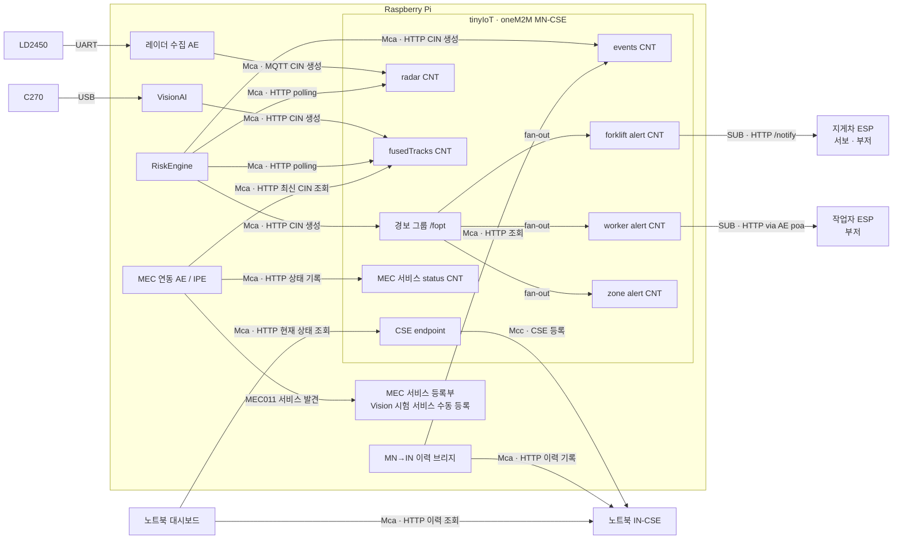

# Sejong_4IoT_OneM2M

**중장비 근접 위험 감지 프로토타입**
oneM2M · ETSI MEC 기반 AIoT 해커톤 · 4IoT 팀

> 최종 수정: 2026-11-20

> **시연에서 확인한 동작 (2026-11-20):** Pi 레이더 업로더가 MQTT로 CIN을 만들고 RiskEngine이 HTTP polling으로 레이더와 Vision 입력을 판단해 경보 그룹에 기록한다. 영상에서 거리 단계, 카메라·레이더 동일 작업자 확인과 쭈그린 자세에 따른 WARNING→DANGER, VisionAI 중단, 레이더 중단 시 UNKNOWN→모형 포크 정지를 보여 준다. 그룹 기록은 세 경보 CNT에 fan-out됐고 작업자 ESP의 DANGER 모드를 확인했다. Pi MN-CSE는 노트북 IN-CSE에 등록되어 있으며 이력은 별도 HTTP/Mca 브리지가 옮기고 노트북 대시보드가 조회한다. Vision의 자동 부팅 등록과 장기 신뢰성은 확인하지 않았다. 11월 20일 점검 시 DHCP 예약은 구성되지 않았다. SG90은 모형 포크를 움직이며 실제 지게차 주행 모터를 제어하지 않는다. 자세한 [아키텍처](docs/architecture.md)와 [배포 기록](docs/deployment.md)를 참고한다.

> **촬영 후 Pi 확인:** RiskEngine Origin은 `Criskengine`이고 입력·기록은 HTTP polling/write다. 운영 그룹에 `macp`를 연결하고 세 alert CNT의 `Criskengine` 권한을 CREATE로 제한했다. events와 세 alert CNT의 기록은 성공했지만 이 ACP 재시험에서는 ESP 알림 수신이나 장치 출력을 확인하지 않았다. MEC IPE는 수동 등록한 Vision 서비스의 주소를 MEC011 등록부에서 발견해 최신 oneM2M 데이터를 조회했다. VisionAI를 잠시 실행했을 때 데이터 상태가 `INACTIVE → ACTIVE`로 바뀌었고 시험 뒤 다시 중지했다. 등록 상태 `ACTIVE`와 데이터 신선도 상태는 별개다.

---

## 1. 프로젝트 개요

### 1.1 배경

지게차와 크레인은 차체 구조상 사각지대가 넓어, 후진이나 선회 중 작업자와 부딪히거나 끼이는 사고가 반복된다. 기존 후방카메라와 경광등은 운전자를 보조할 뿐 작업자에게 직접 경고하지 않고, 장비가 스스로 멈추지도 않는다. UWB·BLE 태그 방식은 작업자가 장비를 착용해야 해서, 미착용이나 배터리 방전 시 보호 공백이 생긴다.

### 1.2 목표 — 아래 기능의 현장 동작을 모두 확인한 것은 아님

| 목표 | 내용 |
|---|---|
| 무태그 감지 | 24GHz mmWave 레이더(HLK-LD2450)로 작업자를 착용 장비 없이 감지한다 |
| 예측형 판단 | 거리와 상대운동 기반 위험 판단을 구현하고, 장비 감속·정지와 작업자 경보를 목표로 한다 |
| 표준 상호운용성 | 모든 데이터를 oneM2M 표준 리소스로 관리해 관제·분석과 타사 장비 연동이 가능하게 한다 |


---

## 2. 확인된 시스템 구성

Pi의 실제 실행 흐름과 시험 경계는 [호출 흐름 그림과 통합 기록](docs/architecture.md)에 정리했다. tinyIoT는 Pi의 **oneM2M MN-CSE**다. 운영 MEC IPE는 서비스 이름으로 Vision 데이터 서비스를 발견하고, 허용된 oneM2M CSE 안의 주소만 조회한다. 서비스 이름과 주소를 분리해 엣지 장비 확장을 위한 경로를 마련했으며, 현재는 한 서비스를 수동 등록해 확인했다. MEP의 앱 배치·관리가 확인되지 않아 MN-CSE, VisionAI, IPE·adapter를 MEC App으로 분류하지 않는다.



그림의 CNT와 그룹은 MN-CSE 안의 리소스다. 그룹은 세 alert CNT의 멤버 참조를 보유하며, zone은 물리 경보 장치가 없는 확장용 CNT다. RiskEngine이 레이더와 Vision CIN을 HTTP polling하고 `events`와 경보 그룹에 HTTP로 기록한다. 레이더 업로더의 radar CIN 생성은 MQTT다. 두 ESP로 가는 SUB 알림은 HTTP다.

MN의 IN 등록은 Mcc 관계이며 이벤트 이력은 별도 브리지가 HTTP로 복사한다. 대시보드는 브라우저와 통신하는 조회 프로그램이며 독립 등록 AE로 확인된 것은 아니다. MEC IPE는 수동 등록된 서비스를 발견해 `fusedTracks`의 신선도를 조회하고 상태를 기록한다. RiskEngine은 이 IPE 상태를 입력으로 사용하지 않는다. 그림은 시연·시험 경로이며 최신 ACP 적용 뒤 두 ESP의 물리 동작까지 재확인한 것은 아니다.

### oneM2M 서버로 tinyIoT를 선택한 이유

초기 기획은 Mobius였으나 tinyIoT로 변경했다. tinyIoT는 C로 작성된 경량 oneM2M CSE라 라즈베리파이에서 부담 없이 동작하고, ETSI MEC 샌드박스에도 MN-CSE로 포함되어 있어 oneM2M과 ETSI MEC를 함께 다루는 대회 조건에 맞는다.

---

## 3. 동작 원리

### 3.1 감지와 위험 판단

LD2450의 2D 표적 좌표로 현재 거리를 계산하고, 연속 좌표와 시간으로 상대속도 및 최근접 시점 `t_cpa`, 최근접 거리 `d_cpa`를 추정한다. `t_cpa`는 위험 반경에 처음 진입하는 시각이 아니라 일정한 상대속도를 가정한 최근접 시각이다. 입력 누락·오래된 데이터는 `UNKNOWN`으로 구분한다.

현재 Pi 시연 설정은 warning 2.5 m, danger 1.5 m, 입력 freshness 5초, 표적 연결 간격 상한 5초다. 팀이 선택한 시연값이며 최적 추적 설정, 산업안전 기준 또는 검증된 제동 거리가 아니다. 별도 11월 18일 모형 시험은 1.0 m/0.5 m를 사용했으므로 녹화 날짜별 설정을 혼합하지 않는다. 센서 좌표계, 장착 오프셋, 실제 표적 유지와 수신 지연은 추가 검증이 필요하다.

### 3.2 경보와 장치 제어

Pi 운영 RiskEngine은 별도 설치 snapshot에서 실행되며, `RADAR_LOCAL_DECISION=0`일 때 엔진이 위험을 판단해 `events`와 경보 그룹에 기록한다. 그룹 `/fopt` fan-out으로 세 alert CNT에 DANGER가 기록되고 worker ESP가 위험 모드에 들어가는 것을 확인했다. 시연에서는 SG90 포크 서보가 모형 포크를 멈추는 장면도 보였다. 카메라는 위험도를 올릴 수 있지만 내리지는 않으며, 레이더 입력이 만료되면 UNKNOWN을 기록하고 모형 포크를 정지한다. 실제 지게차 주행 모터 제어나 안전 인터락은 아니다.

레이더 입력 만료 후 `UNKNOWN`과 SG90 모형 포크 정지는 시연했다. 엔진·CSE·Wi-Fi 자체가 끊겼을 때의 독립 정지, 부팅 후 그룹 복구, 모든 출력 조합과 장기 신뢰성은 검증하지 않았다.

### 3.3 Vision과 IN-CSE

시연 영상에서 VisionAI는 C270 입력을 처리해 레이더와 같은 사람을 confirmed로 연결했고, 쭈그린 자세 신호가 WARNING을 DANGER로 올렸다. 카메라 AI를 중지하는 경우와 레이더 입력이 만료되는 경우도 각각 시연했다. 노트북 대시보드는 MN 현재 상태와 브리지가 IN에 쌓은 이력을 표시한다. VisionAI는 시연 중 실행했으며 부팅 시 자동 시작 설정은 별도 확인 대상이다.

## 4. oneM2M 리소스 설계

### 4.1 리소스 트리

다음 리소스 트리는 Pi에서 조회해 확인한 경로와 그룹 구성을 요약한다. 독립 시험 서버와 운영 Pi는 서로 다른 설정·DB를 사용한다.

```text
TinyIoT-MN                                      [CSEBase]
├─ grp-safezone-alarms                          [GRP] mid → 세 alert CNT 참조
│  └─ fopt                                      [가상 fan-out 요청 지점]
├─ AE-forklift01             [AE]
│  ├─ radar                  [CNT] LD2450 frame CIN
│  └─ alert                  [CNT]
│     └─ sub-alert-node      [SUB] → forklift ESP HTTP /notify
├─ AE-worker01               [AE] lbl type:worker-alarm
│  ├─ alert                  [CNT]
│  │  └─ sub-worker01       [SUB] nu=Cworker01 → AE poa
│  └─ status                 [CNT] worker 상태
├─ AE-riskengine             [AE]
│  └─ events                 [CNT] RiskEngine event history
├─ AE-VisionAI               [AE]
│  └─ fusedTracks            [CNT] camera/radar Vision output
├─ AE-zonealarm01            [AE]
│  └─ alert                  [CNT] group member; no physical zone device
└─ AE-mecIPE                 [AE]
   └─ MecServices            [CNT]
      └─ safezone-vision     [CNT]
         └─ status           [CNT] Vision service-health state
```

트리는 주요 리소스만 요약하며 ACP, CIN 및 추가 SUB 전체 목록은 생략했다. `fopt`는 하위 CNT가 아니라 그룹의 fan-out 요청 지점이다. SUB의 대상 IP와 AE의 `poa`는 네트워크에 따라 바뀔 수 있다.

worker AE 재등록 후 새 alert CNT RI를 경보 그룹 `mid`에 연결했다. 후속 ACP 변경으로 운영 group `macp`와 세 alert CNT에 `Criskengine` CREATE 권한을 설정하고 `cnm=3`을 확인했다. 녹화 시연에서는 `/fopt` fan-out 뒤 worker ESP의 DANGER 모드를 관찰했으며, 촬영 후 ACP 재시험은 세 CNT 기록까지만 확인했다. 정확한 ACP/SUB URI와 서버별 CSE naming은 [배포 기록](docs/deployment.md)에서 구분한다.

주요 리소스 유형: CSEBase(ty 5)는 서버 최상위, ACP(1)는 접근 정책, AE(2)는 애플리케이션, CNT(3)는 데이터 컨테이너, CIN(4)은 개별 데이터, GRP(9)는 그룹, SUB(23)는 변경 알림 설정이다.

리소스에는 `lbl`(라벨)을 붙여 이름을 몰라도 검색으로 찾게 했다(`?fu=1&lbl=safezone:alarm`). 경보 장치는 이 검색으로 그룹 `grp-safezone-alarms`에 묶이고, 경보 작성자는 그룹의 fanOutPoint(`/fopt`)에 한 번 쓴다. 만드는 법은 `python3 onem2m/alarm_group.py`, 설명은 [시연방법.md G절](시연방법.md).

### 4.2 구독 흐름

| 구간 | 현재 상태 |
|---|---|
| radar CIN → RiskEngine | Pi 업로더 MQTT CIN 생성, RiskEngine HTTP polling 확인 |
| RiskEngine → events / alert group | Pi 별도 설치본이 HTTP로 events와 `/fopt` 기록. 세 alert CNT의 DANGER 확인 |
| alert SUB → ESP8266 | Worker `nu=Cworker01` → AE poa 경로와 worker 위험 모드 확인. Forklift `/notify` 경로의 모형 동작은 11/15·11/18 시험 보고 |
| events → IN-CSE | MN→IN 브리지 HTTP polling/write와 노트북 Docker IN 기록 확인 |

MQTT oneM2M binding과 HTTP 요청, oneM2M SUB resource는 서로 다른 층의 기능이다. 현재 MQTT는 radar CIN 생성 구간이고, RiskEngine·Vision write/read, ESP notification, MN→IN bridge는 HTTP다. Pi 운영 MEC IPE가 MEC011에서 수동 등록한 Vision 서비스를 발견하고 실제 oneM2M CIN의 freshness를 조회했다. 여러 엣지 장비에 대한 서비스 자동 등록·주소 갱신, 적절한 서비스 자동 선택과 원격 CSE 연결은 다음 단계다.

### 4.3 데이터 형식 (con)

| 입력·출력 | 현재 코드·시험 가정 | 확인할 사항 |
|---|---|---|
| radar | `x`, `y`: mm; `v`: cm/s. 실제 CIN 예시에 `slot` 포함 보고 | 단위·부호·timestamp·빈 프레임 주기와 슬롯 유지 |
| fusedTracks | `x`, `y`, `dist_m`: m; `ttc_s`: 초 | 원점·축 방향·표적 ID·시각·유효 기간 |
| events | RiskEngine 판단 이력; `status`, `level`, `reason` 등 | 생성·조회와 IN 전달 |
| alert | 장치용 상태 메시지 | 필드·작성 주체 및 UNKNOWN 처리 합의 |

CIN의 `con`은 JSON 문자열일 수 있다. Vision의 `ttc_s`와 RiskEngine의 `t_cpa`는 서로 다른 계산이다. 센서 timestamp와 엔진의 monotonic 수신 시각은 혼용하지 않는다.

예를 들어 radar의 한 표적은 `{"ts": 1760360000.12, "targets": [{"slot": 0, "x": 373, "y": 366, "v": -8}]}` 형태를 사용할 수 있다. 이는 형식 예시이며 슬롯의 추적 연속성·실제 빈 프레임 전송을 보장하지 않는다.

### 4.4 통신 바인딩

| 구간 | 현재 확인 및 목표 |
|---|---|
| LD2450 → Radar Collection IPE | UART, Pi radar uploader |
| Radar IPE → MN-CSE | MQTT oneM2M radar CIN create |
| VisionAI → MN-CSE | C270 USB input; VisionAI HTTP fusedTracks CIN create |
| MN-CSE ↔ RiskEngine | HTTP polling for radar/Vision; HTTP create for events and alert-group `/fopt` |
| alert CNT → ESP | HTTP SUB notification over Mca; worker DANGER mode verified; forklift servo/buzzer in dated model tests |
| MN-CSE → IN-CSE | MN registers with laptop IN over Mcc; a separate bridge AE copies event summaries over HTTP/Mca |
| MEC011 / Vision status | Operational IPE discovered the manually registered `fusedTracks` service and read actual oneM2M data; status changed INACTIVE→ACTIVE during a brief VisionAI run |

## 5. 저장소 구조

```text
Sejong_4IoT_OneM2M/
├─ README.md                    프로젝트 소개
├─ 시연방법.md                  시연 실행 절차 (Pi 한 대로 전체 파이프라인, 서비스, 엔진 경보 모드)
├─ docs/
│  ├─ architecture.md           시스템 구성, 리소스 트리, 호출 흐름
│  ├─ data-format.md            컨테이너별 데이터 형식 (팀 합의 문서)
│  ├─ cse-naming.md             CSE·AE 이름 규칙
│  └─ runbook.md                tinyIoT 운영, MEC 생존 확인 IPE
├─ radar/                       레이더: LD2450 업로더(radar_node.py), 가상 레이더(sim_rader.py)
├─ engine/                      위험 판단 엔진: 거리·CPA, 카메라 결합 규칙, SAFE 해제 지연
├─ vision/                      VisionAI: 카메라 사람·자세 → 바닥 좌표 → 레이더와 결합 → fusedTracks (AGPL-3.0)
├─ onem2m/                      MN→IN 브리지, MEC 생존 확인 IPE, 경보 장치 그룹(lbl+grp), 지연 측정, 구독·CSE 스크립트
├─ dashboard/                   관제 대시보드 (MN 실시간, IN 이력, VisionAI 상태)
├─ esp8266/                     지게차 노드(alert_node), 작업자 노드(worker_node), MQTT 판
├─ systemd/                     Pi 서비스 (radar·engine·bridge·MEC IPE; 로컬 dashboard unit은 임시)
├─ tools/preflight.py           시연 전 점검 (서비스·데이터·경보 작성자·죽은 구독)
├─ experiments/mec011-host-a/   MEC 011 서비스 등록·발견 실험, oneM2M↔MEC 연동 AE
└─ camera/                      (초기 버전) 웹캠 모션 감지
```

Wi-Fi 정보가 들어가는 `secrets.h`는 `.gitignore`로 제외하고, 양식인 `secrets.example.h`만 올린다.

---

## 6. 하드웨어 및 개발 환경

### 6.1 장비

| 장비 | 수량 | 용도 |
|---|---|---|
| HLK-LD2450 24GHz 레이더 | 1 | Pi UART로 작업자 무태그 감지 입력 |
| Raspberry Pi 4B | 1 | tinyIoT MN-CSE, radar uploader, RiskEngine, VisionAI, bridge, MEC IPE |
| Logitech C270 | 1 | USB 카메라; VisionAI가 영상 처리 |
| NodeMCU ESP8266 1.0 + HW-389 | 1 | 축소 지게차 경보 노드 |
| SG90 서보 | 1 | 모형 포크 움직임·정지. 주행 모터가 아님 |
| 능동 부저 TMB12A05 | 2 | 지게차·작업자 경보음 |
| NodeMCU ESP8266 v3 (LoLin) | 1 | 작업자 태그, 부저와 LED 표시창 |
| 9 V 배터리 | 1 | 모형 안의 forklift alarm node 전원 |
| Pi용 5 V, 3 A 전원 | 1 | Raspberry Pi 전원 |
| USB 보조배터리 | 1 | 휴대폰 핫스팟 외부 구성 시험에서 사용 |
| 노트북·휴대폰 핫스팟 | 각 1 | Docker IN-CSE, 시연 대시보드, 네트워크·SSH·펌웨어 업로드 |
| 3D 프린팅 부품 | 필요 수량 | 지게차 축소 모형, 레이더 장착부, 작업자 태그 케이스 |

### 6.2 소프트웨어

| 구분 | 내용 |
|---|---|
| MEC OS | Raspberry Pi OS Lite 64-bit (Debian Trixie) |
| oneM2M CSE | tinyIoT MN-CSE 및 IN-CSE (C, DB는 SQLite) |
| 레이더·RiskEngine·VisionAI·브리지·대시보드·IPE | Python 3 |
| VisionAI | Ultralytics YOLO11n-pose (NCNN), OpenCV |
| MQTT 브로커 | Eclipse Mosquitto (Pi, oneM2M MQTT 바인딩) |
| IN-CSE | Docker 컨테이너 |
| ESP8266 | Arduino IDE, esp8266 보드 패키지 3.1.2, ArduinoJson 7 |
| 개발 도구 | VS Code Remote-SSH, Git/GitHub |
| 3D 모델링 | OpenSCAD |

### 6.3 배선

회로도: [레이더 노드](docs/Schematics%20and%20circuit%20diagrams/1_radar_pi_uart.png) · [지게차 경보 노드](docs/Schematics%20and%20circuit%20diagrams/2_forklift_alarm_node.png) · [작업자 경보 태그](docs/Schematics%20and%20circuit%20diagrams/3_worker_alarm_tag.png)

**① 레이더 노드: LD2450 → Raspberry Pi 4 (UART)**

| LD2450 | Raspberry Pi 4B |
|---|---|
| 5V | 핀 2 (5V) |
| GND | 핀 6 (GND) |
| TX | 핀 10 (GPIO15, RXD) |
| RX | 핀 8 (GPIO14, TXD) |

통신 규격은 256000 bps, 8N1, 3.3 V 레벨이다. `raspi-config`에서 시리얼 로그인 셸은 끄고 시리얼 하드웨어는 켠다. C270은 USB로 Pi에 연결된다. 지게차 모형의 SG90은 포크를 움직이며, 차량 주행 모터가 아니다.

**② 지게차 경보 노드: NodeMCU 1.0 + HW-389 확장보드**

| 부품 | 연결 | 비고 |
|---|---|---|
| SG90 신호 (주황) | D5 (GPIO14) | `Servo.attach(14, 500, 2400)` |
| SG90 + (빨강) | 확장보드 전원 헤더 5V | 신호 열의 V 핀(3.3V)은 쓰지 않음 |
| SG90 − (갈색) | GND | |
| 부저 + (긴 다리) | D6 (GPIO12) | 능동 부저 TMB12A05 |
| 부저 − (짧은 다리) | GND | |
| 9V 건전지 | 확장보드 DC 잭 | 단독 동작 |

tinyIoT 구독 알림(HTTP `/notify`)으로 `AE-forklift01/alert`를 받는다. safe: 포크 왕복 / warn: 왕복 + 느린 경보 / danger·unknown: 포크 정지 + 경보. 내장 LED(GPIO2)는 경보 중 켜진다.

**③ 작업자 경보 태그: NodeMCU v3 (LoLin)**

| 부품 | 연결 |
|---|---|
| 부저 + (긴 다리) | D6 (GPIO12) |
| 부저 − (짧은 다리) | GND |
| USB 보조배터리 | micro-USB |

켜지면 tinyIoT에 `AE-worker01`로 스스로 등록한다(`lbl type:worker-alarm`). warn: 느린 경보, danger: 빠른 경보, 내장 LED가 부저와 함께 깜빡인다.

초기 목표 배선안(ESP8266이 레이더를 직접 읽고 아두이노가 모터 드라이버를 제어)은 채택하지 않았다. 레이더는 Pi UART로 읽고, 경보 장치는 oneM2M 구독 알림을 받아 ESP8266이 직접 서보·부저를 제어한다.

---

## 7. 라이선스

대회 규정에 따라 소스 코드는 Apache License 2.0, 코드가 아닌 자료는 CC BY 4.0으로 공개한다. 단, VisionAI는 AGPL-3.0인 Ultralytics YOLO11을 사용하므로 `vision/`만 AGPL-3.0이다.

| 부분 | 라이선스 | 이유 |
|---|---|---|
| `engine/`, `radar/`, `onem2m/`, `esp8266/`, `camera/` 코드 | Apache 2.0 ([LICENSE](LICENSE)) | 대회 소스 코드 규정 |
| `vision/` (VisionAI) | AGPL-3.0 ([vision/LICENSE](vision/LICENSE)) | Ultralytics YOLO11(AGPL-3.0) 사용 |
| 문서(`docs/`, README), 발표 자료, 시연 영상 | CC BY 4.0 | 대회 비코드 자료 규정 |

각 부분은 따로 실행되는 프로그램이고 oneM2M CSE(HTTP/MQTT)로만 데이터를 주고받는다. 서로 코드를 링크하지 않으므로 `vision/`의 AGPL-3.0 조건은 Apache 2.0 부분에 적용되지 않는다. 대회 라이선스 멘토가 2026-11-13에 이 구분을 검토했고 대회에 문제가 없다고 답했다. VisionAI의 외부 라이브러리 라이선스는 [vision/README.md](vision/README.md#license)에 있다.

**License (English):** Source code is Apache 2.0 ([LICENSE](LICENSE)), except `vision/`, which is AGPL-3.0 because it uses Ultralytics YOLO11. Non-code content is CC BY 4.0. The parts run as separate programs and talk only through the oneM2M CSE, so the AGPL-3.0 terms of `vision/` do not extend to the rest.
