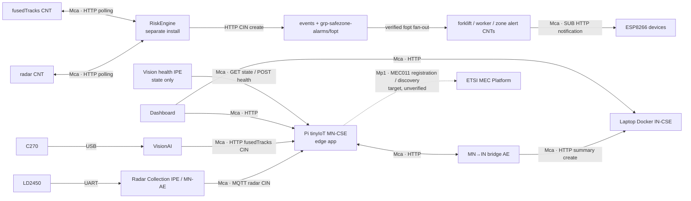

# Sejong_4IoT_OneM2M

**중장비 근접 위험 감지 프로토타입**
oneM2M · ETSI MEC 기반 AIoT 해커톤 · 4IoT 팀

> 최종 수정: 2026-11-20

> **실제 배치 상태 (2026-11-20):** Pi 레이더 CIN 수집은 MQTT, RiskEngine 입력·기록은 HTTP polling/create이며, 경보 그룹 fan-out으로 DANGER가 세 alert CNT에 기록되고 작업자 ESP가 위험 모드에 들어가는 것을 확인했다. worker AE 재등록 뒤 그룹 멤버 RI도 복구했다. 두 ESP 보드가 동작한다. C270을 인식했고 VisionAI 수동 실행에서 fresh `fusedTracks`를 RiskEngine이 읽었지만 `tracks`는 비어 있었다. Vision 상시 실행이나 사람 검출은 확인하지 않았다. 11월 15일·18일 모형 시험에서 SG90 포크 서보와 부저 동작을 보고했으며 실제 지게차 주행 모터 제어는 아니다. DHCP 예약, 재부팅 복구 및 안전 성능은 미검증이다. 자세한 [아키텍처](docs/architecture.md)와 [배포 기록](docs/deployment.md)를 참고한다.

---

## 1. 프로젝트 개요

### 1.1 배경

지게차와 크레인은 차체 구조상 사각지대가 넓어, 후진이나 선회 중 작업자와 부딪히거나 끼이는 사고가 반복된다. 기존 후방카메라와 경광등은 운전자를 보조할 뿐 작업자에게 직접 경고하지 않고, 장비가 스스로 멈추지도 않는다. UWB·BLE 태그 방식은 작업자가 장비를 착용해야 해서, 미착용이나 배터리 방전 시 보호 공백이 생긴다.

### 1.2 목표 — 아래 기능의 현장 동작을 모두 확인한 것은 아님

| 목표 | 내용 |
|---|---|
| 무태그 감지 | 24GHz mmWave 레이더(HLK-LD2450)로 작업자를 착용 장비 없이 감지한다 |
| 예측형 판단 | 거리와 상대운동 기반 위험 판단을 구현하고, 장비 감속·정지와 작업자 경보를 목표로 한다 |
| 표준 상호운용성 | 모든 데이터를 oneM2M 표준 리소스로 관리해 관제·분석과 타사 장비 연동이 가능하게 한다 |


---

## 2. 확인된 시스템 구성

현재 Pi의 실행 흐름은 [호출 흐름 그림과 통합 기록](docs/architecture.md)에 상세히 정리했다. 실선 경로는 실제 배치 또는 날짜를 기록한 시험이며, 점선의 Mp1/MEC011 링크는 목표 구조다. tinyIoT MN-CSE는 Pi edge의 oneM2M 서비스이며, 대회 참조 그림에서는 MEC App 역할로 대응해 표시한다. 실제 ETSI MEC 플랫폼 등록·발견은 연결·검증하지 않았다.



Radar 업로더만 Pi에서 MQTT로 radar CIN을 만든다. RiskEngine은 radar와 설정된 Vision CIN을 HTTP polling하고, `events`와 경보 그룹에 HTTP로 쓴다. VisionAI는 USB 카메라 영상을 처리해 HTTP로 `fusedTracks`를 쓴다. ESP 구독 알림과 MN→IN bridge도 HTTP이며, 이력 이동은 브리지 AE가 양쪽 CSE에 Mca 요청을 보내는 구조로 직접 Mcc가 아니다.

### oneM2M 서버로 tinyIoT를 선택한 이유

초기 기획은 Mobius였으나 tinyIoT로 변경했다. tinyIoT는 C로 작성된 경량 oneM2M CSE라 라즈베리파이에서 부담 없이 동작하고, ETSI MEC 샌드박스에도 MN-CSE로 포함되어 있어 oneM2M과 ETSI MEC를 함께 다루는 대회 조건에 맞는다.

---

## 3. 동작 원리

### 3.1 감지와 위험 판단

LD2450의 2D 표적 좌표로 현재 거리를 계산하고, 연속 좌표와 시간으로 상대속도 및 최근접 시점 `t_cpa`, 최근접 거리 `d_cpa`를 추정한다. `t_cpa`는 위험 반경에 처음 진입하는 시각이 아니라 일정한 상대속도를 가정한 최근접 시각이다. 입력 누락·오래된 데이터는 `UNKNOWN`으로 구분한다.

현재 Pi 시연 설정은 warning 2.5 m, danger 1.5 m, 입력 freshness 5초, 표적 연결 간격 상한 5초다. 팀이 선택한 시연값이며 최적 추적 설정, 산업안전 기준 또는 검증된 제동 거리가 아니다. 별도 11월 18일 모형 시험은 1.0 m/0.5 m를 사용했으므로 녹화 날짜별 설정을 혼합하지 않는다. 센서 좌표계, 장착 오프셋, 실제 표적 유지와 수신 지연은 추가 검증이 필요하다.

### 3.2 경보와 장치 제어

Pi 운영 RiskEngine은 별도 설치 snapshot에서 실행되며, `RADAR_LOCAL_DECISION=0`일 때 엔진이 `events`와 경보 그룹을 기록한다. 그룹 `/fopt` fan-out으로 세 alert CNT에 DANGER가 기록됐고, worker ESP가 위험 모드에 들어가는 것을 확인했다. worker AE 재등록 뒤 alert CNT RI가 바뀌어 그룹 `mid`를 다시 연결했다. 11월 15일·18일 모형 시험에서는 WARN/DANGER에 따른 SG90 포크 서보와 부저 동작을 보고했다. 이는 실제 지게차 주행 모터 정지나 안전 인터락이 아니다.

네트워크 단절 시 독립 정지, `UNKNOWN` 시 fail-safe 동작, 부팅 후 그룹 복구, 모든 출력 조합과 장기 신뢰성은 검증하지 않았다.

### 3.3 Vision과 IN-CSE

2026-11-20 장비 복구 뒤 C270을 인식하고 `/home/user/vision4iot` 환경에서 VisionAI를 수동 실행해 fresh `fusedTracks`를 만들었으며 RiskEngine이 fresh로 읽는 것을 확인했다. 당시 `tracks=[]`여서 이 결과는 입력·호출 경로 확인이지 사람 검출 확인이 아니다. systemd 상시 실행은 미검증이다. Pi 브리지는 MN events를 HTTP polling해 노트북 Docker IN에 기록하고, 대시보드에서 MN 상태와 IN 이력을 조회하는 것을 확인했다. 이 브리지 방식은 직접 Mcc가 아니다.

## 4. oneM2M 리소스 설계

### 4.1 리소스 트리

다음 리소스 트리는 Pi에서 조회해 확인한 경로와 그룹 구성을 요약한다. 독립 시험 서버와 운영 Pi는 서로 다른 설정·DB를 사용한다.

```text
TinyIoT-MN
├─ grp-safezone-alarms       [GRP] forklift / worker / zone alert CNT 3개
├─ AE-forklift01             [AE]
│  ├─ radar                  [CNT] LD2450 frame CIN
│  └─ alert                  [CNT] forklift SUB uses HTTP /notify
├─ AE-worker01               [AE] lbl type:worker-alarm
│  └─ alert                  [CNT] worker SUB nu=Cworker01 → AE poa
├─ AE-riskengine             [AE]
│  └─ events                 [CNT] RiskEngine event history
├─ AE-VisionAI               [AE]
│  └─ fusedTracks            [CNT] camera/radar Vision output
├─ AE-zonealarm01            [AE]
│  └─ alert                  [CNT] group member; no physical zone device
└─ AE-mecIPE                 [AE]
   └─ status                 [CNT] Vision service-health state
```

worker AE를 재등록한 뒤 새 alert CNT RI를 경보 그룹 `mid`에 복원했다. 이후 `/fopt` DANGER 쓰기가 세 alert CNT에 각각 기록되고 worker ESP가 위험 모드에 들어가는 것을 확인했다. worker ACP에는 `CAdmin` create/retrieve/discovery 권한(마스크 35)이 있으므로 최소 권한은 별도 검토 대상이다. 정확한 ACP/SUB URI와 서버별 CSE naming은 [배포 기록](docs/deployment.md)에서 구분한다.

주요 리소스 유형: CSEBase(ty 5)는 서버 최상위, ACP(1)는 접근 정책, AE(2)는 애플리케이션, CNT(3)는 데이터 컨테이너, CIN(4)은 개별 데이터, GRP(9)는 그룹, SUB(23)는 변경 알림 설정이다.

리소스에는 `lbl`(라벨)을 붙여 이름을 몰라도 검색으로 찾게 했다(`?fu=1&lbl=safezone:alarm`). 경보 장치는 이 검색으로 그룹 `grp-safezone-alarms`에 묶이고, 경보 작성자는 그룹의 fanOutPoint(`/fopt`)에 한 번 쓴다. 만드는 법은 `python3 onem2m/alarm_group.py`, 설명은 [시연방법.md G절](시연방법.md).

### 4.2 구독 흐름

| 구간 | 현재 상태 |
|---|---|
| radar CIN → RiskEngine | Pi 업로더 MQTT CIN 생성, RiskEngine HTTP polling 확인 |
| RiskEngine → events / alert group | Pi 별도 설치본이 HTTP로 events와 `/fopt` 기록. 세 alert CNT의 DANGER 확인 |
| alert SUB → ESP8266 | Worker `nu=Cworker01` → AE poa 경로와 worker 위험 모드 확인. Forklift `/notify` 경로의 모형 동작은 11/15·11/18 시험 보고 |
| events → IN-CSE | MN→IN 브리지 HTTP polling/write와 노트북 Docker IN 기록 확인 |

MQTT oneM2M binding과 HTTP 요청, oneM2M SUB resource는 서로 다른 층의 기능이다. 현재 MQTT는 radar CIN 생성 구간이고, RiskEngine·Vision write/read, ESP notification, MN→IN bridge는 HTTP다. 외부 MEC011 연결은 미검증이다.

### 4.3 데이터 형식 (con)

| 입력·출력 | 현재 코드·시험 가정 | 확인할 사항 |
|---|---|---|
| radar | `x`, `y`: mm; `v`: cm/s. 실제 CIN 예시에 `slot` 포함 보고 | 단위·부호·timestamp·빈 프레임 주기와 슬롯 유지 |
| fusedTracks | `x`, `y`, `dist_m`: m; `ttc_s`: 초 | 원점·축 방향·표적 ID·시각·유효 기간 |
| events | RiskEngine 판단 이력; `status`, `level`, `reason` 등 | 생성·조회와 IN 전달 |
| alert | 장치용 상태 메시지 | 필드·작성 주체 및 UNKNOWN 처리 합의 |

CIN의 `con`은 JSON 문자열일 수 있다. Vision의 `ttc_s`와 RiskEngine의 `t_cpa`는 서로 다른 계산이다. 센서 timestamp와 엔진의 monotonic 수신 시각은 혼용하지 않는다.

예를 들어 radar의 한 표적은 `{"ts": 1760360000.12, "targets": [{"slot": 0, "x": 373, "y": 366, "v": -8}]}` 형태를 사용할 수 있다. 이는 형식 예시이며 슬롯의 추적 연속성·실제 빈 프레임 전송을 보장하지 않는다.

### 4.4 통신 바인딩

| 구간 | 현재 확인 및 목표 |
|---|---|
| LD2450 → Radar Collection IPE | UART, Pi radar uploader |
| Radar IPE → MN-CSE | MQTT oneM2M radar CIN create |
| VisionAI → MN-CSE | C270 USB input; VisionAI HTTP fusedTracks CIN create |
| MN-CSE ↔ RiskEngine | HTTP polling for radar/Vision; HTTP create for events and alert-group `/fopt` |
| alert CNT → ESP | HTTP SUB notification over Mca; worker DANGER mode verified; forklift servo/buzzer in dated model tests |
| MN→IN bridge AE | HTTP/Mca polling on MN and HTTP/Mca summary create on laptop Docker IN; no direct Mcc |
| MN-CSE ↔ MEC Platform | Mp1/MEC011 registration/discovery is target mapping only; not live-verified |

## 5. 저장소 구조

```text
Sejong_4IoT_OneM2M/
├─ README.md                    프로젝트 소개
├─ 시연방법.md                  시연 실행 절차 (Pi 한 대로 전체 파이프라인, 서비스, 엔진 경보 모드)
├─ docs/
│  ├─ architecture.md           시스템 구성, 리소스 트리, 호출 흐름
│  ├─ data-format.md            컨테이너별 데이터 형식 (팀 합의 문서)
│  ├─ cse-naming.md             CSE·AE 이름 규칙
│  └─ runbook.md                tinyIoT 운영, MEC 생존 확인 IPE
├─ radar/                       레이더: LD2450 업로더(radar_node.py), 가상 레이더(sim_rader.py)
├─ engine/                      위험 판단 엔진: 거리·CPA, 카메라 결합 규칙, SAFE 해제 지연
├─ vision/                      VisionAI: 카메라 사람·자세 → 바닥 좌표 → 레이더와 결합 → fusedTracks (AGPL-3.0)
├─ onem2m/                      MN→IN 브리지, MEC 생존 확인 IPE, 경보 장치 그룹(lbl+grp), 지연 측정, 구독·CSE 스크립트
├─ dashboard/                   관제 대시보드 (MN 실시간, IN 이력, VisionAI 상태)
├─ esp8266/                     지게차 노드(alert_node), 작업자 노드(worker_node), MQTT 판
├─ systemd/                     시연 서비스 (radar·engine·bridge·dashboard·IPE; VisionAI 최신 확인은 수동 실행)
├─ tools/preflight.py           시연 전 점검 (서비스·데이터·경보 작성자·죽은 구독)
├─ experiments/mec011-host-a/   MEC 011 서비스 등록·발견 실험, oneM2M↔MEC 연동 AE
└─ camera/                      (초기 버전) 웹캠 모션 감지
```

Wi-Fi 정보가 들어가는 `secrets.h`는 `.gitignore`로 제외하고, 양식인 `secrets.example.h`만 올린다.

---

## 6. 하드웨어 및 개발 환경

### 6.1 장비

| 장비 | 수량 | 용도 |
|---|---|---|
| HLK-LD2450 24GHz 레이더 | 1 | Pi UART로 작업자 무태그 감지 입력 |
| Raspberry Pi 4B | 1 | tinyIoT MN-CSE, radar uploader, RiskEngine, bridge, dashboard, health IPE |
| Logitech C270 | 1 | USB 카메라; VisionAI가 영상 처리 |
| NodeMCU ESP8266 + HW-389 | 1 | 축소 지게차 경보 노드 |
| SG90 서보 + 부저 | 각 1 | 모형 포크 움직임·정지와 경보음. 주행 모터가 아님 |
| NodeMCU ESP8266 | 1 | 작업자 태그, 부저와 LED 표시창 |
| 9 V 배터리 | 1 | 모형 안의 forklift alarm node 전원 |
| Pi용 5 V, 3 A 전원 | 1 | Raspberry Pi 전원 |
| USB 보조배터리 | 1 | 휴대폰 핫스팟 외부 구성 시험에서 사용 |
| 노트북 | 1 | Docker IN-CSE |
| 3D 프린팅 부품 | 필요 수량 | 지게차 축소 모형, 레이더 장착부, 작업자 태그 케이스 |

### 6.2 소프트웨어

| 구분 | 내용 |
|---|---|
| MEC OS | Raspberry Pi OS Lite 64-bit (Debian Trixie) |
| oneM2M CSE | tinyIoT (C, DB는 SQLite) |
| 레이더·RiskEngine·VisionAI·브리지·대시보드·IPE | Python 3 |
| VisionAI | Ultralytics YOLO, OpenCV |
| IN-CSE | Docker 컨테이너 |
| ESP8266 | Arduino IDE, ESP8266 board package, ArduinoJson |
| oneM2M CSE | tinyIoT MN-CSE 및 IN-CSE |
| 개발 도구 | VS Code Remote-SSH, Git/GitHub |

### 6.3 배선

**현재 프로토타입 (LD2450 → 라즈베리파이 UART)**

| LD2450 | Raspberry Pi 4B |
|---|---|
| 5V | 핀 2 (5V) |
| GND | 핀 6 |
| TX | 핀 10 (GPIO15, RXD) |
| RX | 핀 8 (GPIO14, TXD) |

통신 규격은 256000 bps, 8N1, 3.3 V 레벨이다. C270은 USB로 Pi에 연결된다. ESP 보드의 전체 GPIO 배선도는 프로젝트 파일에서 검증된 회로도를 찾지 못해 여기서 핀 번호를 추정하지 않는다. 지게차 모형의 SG90은 포크를 움직이며, 차량 주행 모터/드라이버를 제어하는 회로가 아니다.

---

## 7. 라이선스

대회 규정에 따라 소스 코드는 Apache License 2.0, 코드가 아닌 자료는 CC BY 4.0으로 공개한다. 단, VisionAI는 AGPL-3.0인 Ultralytics YOLO11을 사용하므로 `vision/`만 AGPL-3.0이다.

| 부분 | 라이선스 | 이유 |
|---|---|---|
| `engine/`, `radar/`, `onem2m/`, `esp8266/`, `camera/` 코드 | Apache 2.0 ([LICENSE](LICENSE)) | 대회 소스 코드 규정 |
| `vision/` (VisionAI) | AGPL-3.0 ([vision/LICENSE](vision/LICENSE)) | Ultralytics YOLO11(AGPL-3.0) 사용 |
| 문서(`docs/`, README), 발표 자료, 시연 영상 | CC BY 4.0 | 대회 비코드 자료 규정 |

각 부분은 따로 실행되는 프로그램이고 oneM2M CSE(HTTP/MQTT)로만 데이터를 주고받는다. 서로 코드를 링크하지 않으므로 `vision/`의 AGPL-3.0 조건은 Apache 2.0 부분에 적용되지 않는다. 대회 라이선스 멘토가 2026-11-13에 이 구분을 검토했고 대회에 문제가 없다고 답했다. VisionAI의 외부 라이브러리 라이선스는 [vision/README.md](vision/README.md#license)에 있다.

**License (English):** Source code is Apache 2.0 ([LICENSE](LICENSE)), except `vision/`, which is AGPL-3.0 because it uses Ultralytics YOLO11. Non-code content is CC BY 4.0. The parts run as separate programs and talk only through the oneM2M CSE, so the AGPL-3.0 terms of `vision/` do not extend to the rest.
