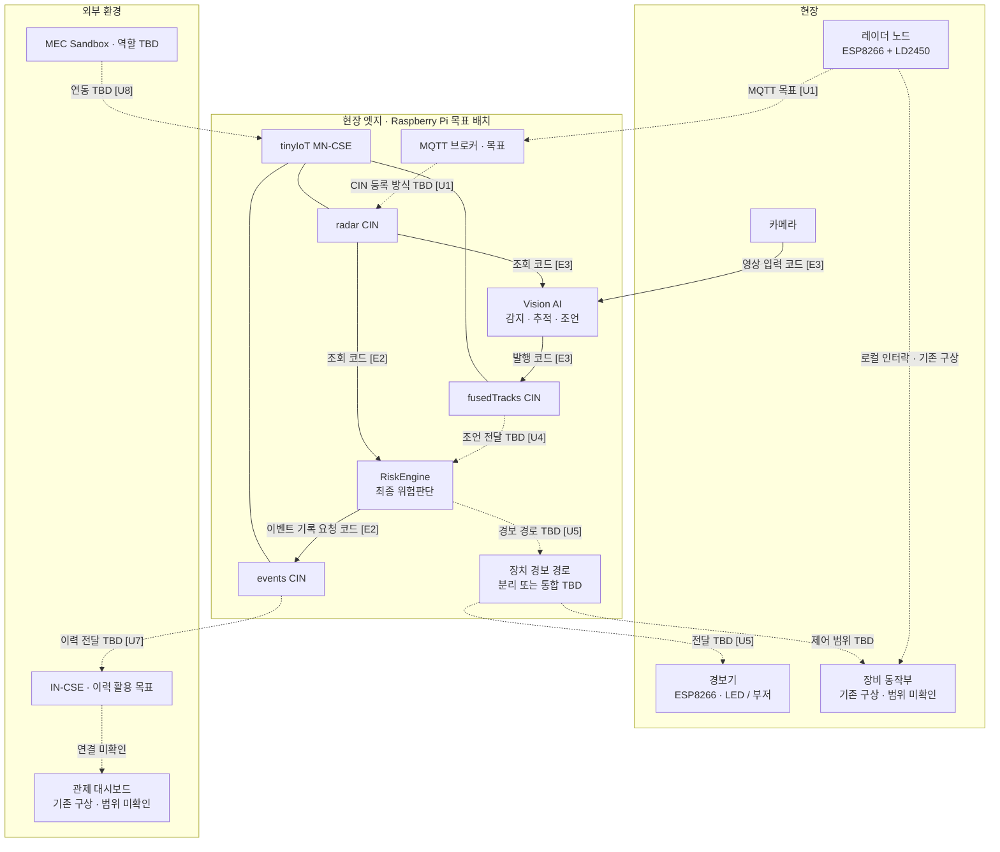
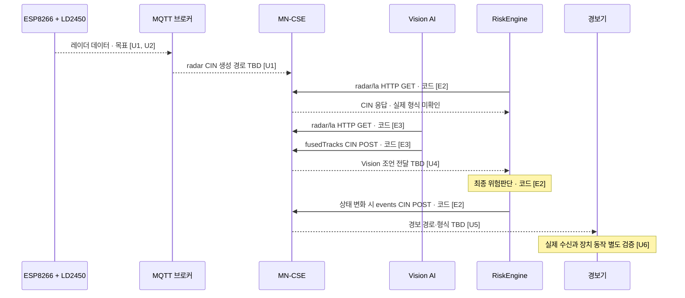

# SafeZone 아키텍처

## 문서 상태와 범위

| 항목 | 내용 |
|---|---|
| 기준 | 로컬 `main`의 `c73e62f6042ab90f27ba25fa3e2ec2bd65b8201a` 정적 조사 |
| 조사일 | 2026-11-09 |
| 한계 | 현재 GitHub 상태, Pi 설정, 실제 장비와 종단 간 동작은 확인하지 못했다. |
| 목적 | 팀이 목표 구조와 미결정 인터페이스를 검토하고 향후 구현·검증의 기준으로 삼는다. |

SafeZone은 지게차와 작업자 사이의 위험을 감지하고 경고하는 해커톤 MVP다. 인증된 산업안전 시스템으로 취급하지 않는다. 코드 존재와 목표 설계는 실제 장비의 동작 검증을 뜻하지 않는다.

**상태 표기:** `코드`는 저장소에 구현이 있지만 실제 통합은 미검증인 항목, `목표`는 팀이 지향하는 구조, `TBD`는 결정이 필요한 항목, `미확인`은 정보나 실행 증거가 없는 항목이다. 이 문서에서는 실제 환경과 시점이 명확한 실행 증거를 확보하지 못해 관찰된 운영 경로를 확정하지 않는다.

## 책임과 시스템 경계

- 레이더 노드는 지게차에 장착되는 ESP8266 + LD2450 구성을 지향한다. MQTT 브로커는 Raspberry Pi에서 실행할 계획이다. [E1, U1]
- RiskEngine은 레이더 데이터를 사용해 **최종 위험판단**을 담당한다. [E2, D1]
- Vision AI는 카메라·레이더 정보를 처리하여 판단을 위한 **조언**을 제공한다. 조언을 RiskEngine에 전달하고 반영하는 방법은 미결정이다. [E3, D1, U4]
- Pi의 tinyIoT MN-CSE, 별도 IN-CSE 및 MEC Sandbox를 활용하는 방향이다. 실제 등록, 이력 전달과 Sandbox 연동은 미확인이다. [E1, E4, U7, U8]

## 전체 구성도

실선은 관련 코드가 확인된 연결이고 점선은 목표 또는 미결정 연결이다. **실선도 실제 통합 성공을 뜻하지 않는다.** CSE와 리소스 사이의 선은 포함 관계다. 물리적 배치 또한 목표이며 현재 Pi 상태를 보장하지 않는다.

## 데이터 흐름 상세도

| 구간 | 생산자 → 소비자 / 방식 | 코드·형식 및 확인 상태 |
|---|---|---|
| 레이더 → radar | ESP8266 → MQTT → MN-CSE | 일반 MQTT, oneM2M MQTT 바인딩, 별도 변환 중 실제 방식은 TBD. 브로커 연결만으로 CIN 생성 성공을 뜻하지 않는다. [E4, U1] |
| radar → RiskEngine | MN-CSE → RiskEngine, HTTP 폴링 또는 알림 | 기본 폴링은 `AE-forklift01/radar/la`. `con` 객체 또는 JSON 문자열을 처리하는 코드가 있다. 알림 구독은 엔진이 생성하지 않는다. 실제 데이터 호환성 미검증. [E2] |
| radar → Vision | MN-CSE → Vision, HTTP 조회 | 같은 radar 경로를 읽는 코드. Vision의 별도 업로더는 시뮬레이션 입력용이다. [E3] |
| Vision → RiskEngine | Vision → `AE-VisionAI/fusedTracks` → RiskEngine | Vision의 결과 발행 코드는 있으나 RiskEngine 소비·판단 반영은 확인되지 않았다. 전달 방식과 계약 TBD. [E3, E4, U4] |
| RiskEngine → events | RiskEngine → MN-CSE, HTTP POST | 상태 변화 때 `AE-riskengine/events`에 CIN 생성 요청. 실제 생성 결과 미확인. [E2] |
| 판단 → 경보기 | RiskEngine → 경보기 | `events`와 `alert`의 분리 여부 및 형식 TBD. 현재 엔진의 `alert` 출력은 확인되지 않았다. ESP는 `/notify`를 받는 코드가 있다. [E2, E5, U5] |
| MN-CSE → IN-CSE | CSE 간 연결 | 등록, 원격 접근, 데이터 전달·이력 저장을 각각 확인해야 한다. 등록만으로 CIN 복제를 가정하지 않는다. [E4, U7] |
| MEC ↔ oneM2M | MEC Sandbox ↔ CSE | 역할과 연결 방법 TBD. 시뮬레이션과 실제 네트워크 효과를 구분한다. [U8] |

## 기존 코드와 목표의 차이

RiskEngine은 거리와 연속 좌표 기반 상대 움직임을 사용해 `SAFE`, `WARNING`, `DANGER`, `UNKNOWN`을 판단한다. 센서 `ts`는 메타데이터로 보존하며 신선도 판단에 쓰지 않는다. 새 CIN이 일정 시간 오지 않으면 `UNKNOWN`으로 처리한다. 빈 프레임의 실제 전송 여부는 미확인이다. [E2, U2, U3]

기존 `radar/radar_node.py`는 Pi 직렬 포트를 읽고 HTTP `/on`·`/off`를 호출한다. 현재 `alert_node.ino`는 `/notify`를 등록한다. 이 두 파일을 그대로 연결하면 경로가 다르며 실제 사용 조합은 미확인이다. 커밋되지 않은 `radar/cin_uploader.py`와 `radar/CIN_UPLOADER.md`는 ESP8266 + MQTT의 확정 구현으로 취급하지 않는다. [E5, E6]

기존 README의 장비 동작부·로컬 인터락·대시보드는 구상으로 표시한다. 실제 구현과 이번 마일스톤의 포함 범위는 팀 확인이 필요하다. [E1]

## 결정·검증 현황과 잠정 전제

문제 발생 시 ID를 이용해 관련 흐름·결정·검증 기록을 함께 추적한다. 실측 전에는 코드상 가정을 실제 센서의 계약으로 확정하지 않는다.

| ID | 전제·결정 항목 / 상태 | 전제가 틀릴 때 나타날 수 있는 현상 | 확인 방법 / 담당 분야 |
|---|---|---|---|
| U1 | MQTT → radar CIN 등록 방식 **TBD** | MQTT는 연결되지만 `radar/la`가 갱신되지 않음 | 토픽·요청·응답·CSE ID·권한·CIN 조회 확인 / 레이더·플랫폼 |
| U2 | 좌표 mm, 속도 cm/s는 소비자 코드의 **가정** | 거리나 접근 방향을 잘못 판단 | 실제 프레임과 실측 거리, 축·설치 방향, 속도 의미·부호 / 레이더·엔진·Vision |
| U3 | timestamp·표적 슬롯·빈 프레임 계약 **미확인** | 잘못된 속도 추정, 지속적 UNKNOWN, 잘못된 상태 복귀 | 시간 기록 시점, 슬롯 유지, 빈 프레임과 CIN 주기 / 레이더·엔진 |
| U4 | Vision 조언 전달·반영 규칙 **TBD** | 오래된 조언이나 다른 표적의 조언을 사용 | 스키마, 좌표계, 표적 연결, 유효 시간, 누락·충돌 처리 / Vision·엔진 |
| U5 | `events`와 `alert`의 분리·통합 **TBD** | 기록은 있으나 경보기 무반응 또는 중복 경보 | 리소스·구독 경로, 형식, 발행·수신 응답 / 엔진·장치·플랫폼 |
| U6 | UNKNOWN·단절·전달 실패 시 장치 동작 **TBD** | 마지막 상태가 지속되거나 위험 여부를 알 수 없음 | 장치 표시, 유효 시간, 재시도·재시작·재연결 정책 / 엔진·장치 |
| U7 | MN → IN 이력 전달 방식 **TBD** | MN에는 기록이 있으나 IN에는 없음 | CSE 등록, 접근 권한, 전달 및 IN 조회를 각각 확인 / 플랫폼 |
| U8 | MEC Sandbox 역할·연동 **TBD** | 시뮬레이션을 실제 연동으로 오인 | 입출력, oneM2M 접점과 시험 환경 / MEC·플랫폼 |
| U9 | 저장소 CSE 이름과 권한 설정의 Pi 적용 여부 **미확인** | 경로 조회 실패 또는 권한 오류 | 실제 CSEBase 이름·ID, AE/CNT/SUB/ACP와 클라이언트 설정 / 플랫폼 |
| D1 | RiskEngine 최종 판단, Vision 조언 제공 **팀 방향** | 책임 경계가 불명확해 다른 구성요소가 상충하는 제어를 내림 | 인터페이스와 판단 우선순위를 구체화 / 엔진·Vision |

## 팀 결정: events와 alert

현재 RiskEngine은 상태 변화 시 `events`에 판단 이력 CIN을 생성하도록 요청한다. 장치용 `alert` 발행 코드는 확인되지 않았다. [E2]

| 선택지 | 장점 | 비용·위험 |
|---|---|---|
| **분리**: `events`는 판단 이력, `alert`는 장치용 경보 상태 | 이력과 장치 메시지의 목적·형식을 독립적으로 관리하기 쉽다. | 발행 경로가 늘고 한쪽만 성공할 수 있어 오류 기록·재시도 설계가 필요하다. |
| **통합**: 경보기가 `events`를 구독 | 별도 `alert` 발행 없이 MVP를 단순화할 수 있다. | 이력과 장치가 같은 형식에 의존하고, 장치별 정책이나 스키마 변경의 영향을 함께 고려해야 한다. |

**잠정 권고: 분리. 팀 결정은 아직 필요하다.** 어느 쪽이든 CIN 생성 성공은 알림 수신이나 실제 LED·부저 동작 성공을 보장하지 않는다. 현재처럼 상태가 바뀔 때만 발행하면 메시지 누락·장치 재시작 후 현재 상태 복구도 결정해야 한다. [U5, U6]

## 검증 계획

1. 실제 레이더 프레임으로 단위·방향·시간·슬롯·빈 프레임을 확인한다. [U2, U3]
2. MQTT 요청·응답과 `radar/la` 생성 여부를 각각 확인한다. [U1]
3. 실제 radar 입력, RiskEngine 판단 및 events CIN 생성을 단계별로 확인한다. [E2]
4. Vision 조언 계약을 정하고 RiskEngine의 수신과 반영을 확인한다. [U4]
5. 경보 발행, 알림 수신, 실제 장치 동작과 장애 복구를 각각 검증한다. [U5, U6]
6. CSE 간 등록·전달과 MEC Sandbox 연동을 별도로 검증한다. [U7, U8]

검증 기록에는 일시, commit, 장비·환경, 절차, 결과와 로그 출처를 남기고 모의 시험과 실제 장비 시험을 구분한다.

## 근거

다음은 로컬 `main` `c73e62f`의 코드·문서이며 별도 명시가 없는 한 실행 증거가 아니다. 현재 GitHub 상태나 실제 장비 동작을 입증하지 않는다.

| ID | 출처 | 확인 범위 |
|---|---|---|
| E1 | [README.md](../README.md) | 기존 목표 구성과 리소스 구상 |
| E2 | [engine/README.md](../engine/README.md), [engine/main.py](../engine/main.py), [engine/onem2m_http.py](../engine/onem2m_http.py) | 엔진 입력·판단·이벤트 생성 요청 코드와 가정 |
| E3 | [vision/config.yaml](../vision/config.yaml), [vision main](../vision/src/vision4iot/main.py), [radar uploader](../vision/src/vision4iot/radar_uploader.py) | Vision 입력·출력과 시뮬레이션 업로더 |
| E4 | [docs/cse-naming.md](cse-naming.md) | 이름 제안과 통합 미검증 기록 |
| E5 | [alert_node.ino](../esp8266/led_server/alert_node.ino), [sub_alert_node.sh](../onem2m/sub_alert_node.sh) | 알림 수신 펌웨어와 구독 스크립트 |
| E6 | [radar/radar_node.py](../radar/radar_node.py) | Pi 직렬 입력과 HTTP 장치 요청 코드 |

팀 방향 D1 및 MQTT 브로커 배치·마일스톤은 사용자와의 설계 논의를 바탕으로 한 목표이며 실행 검증을 뜻하지 않는다.
