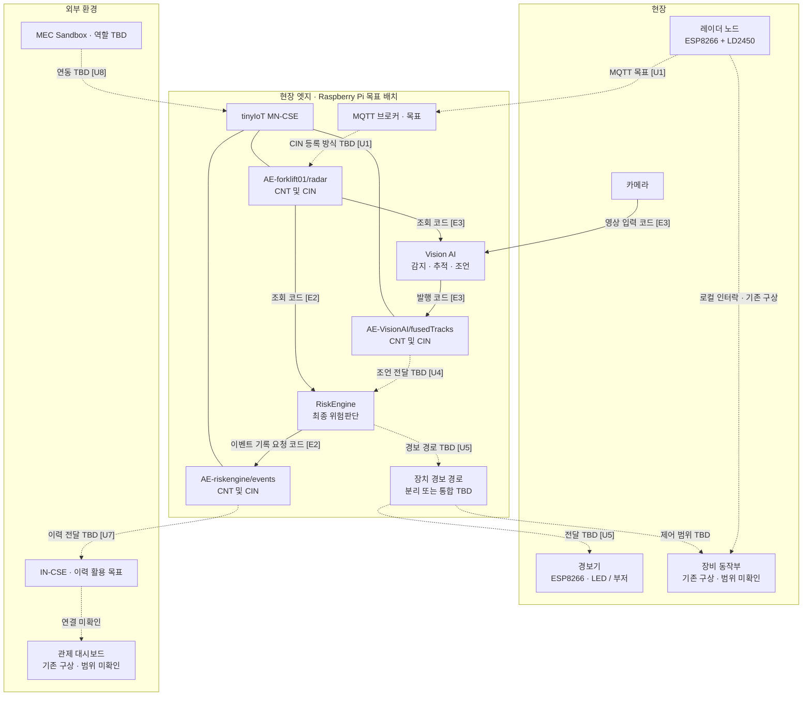
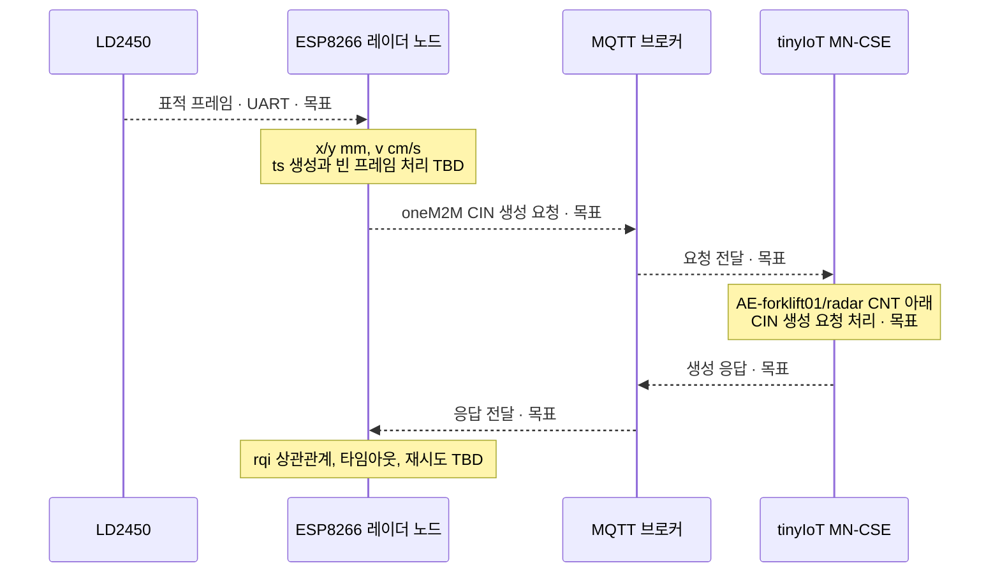
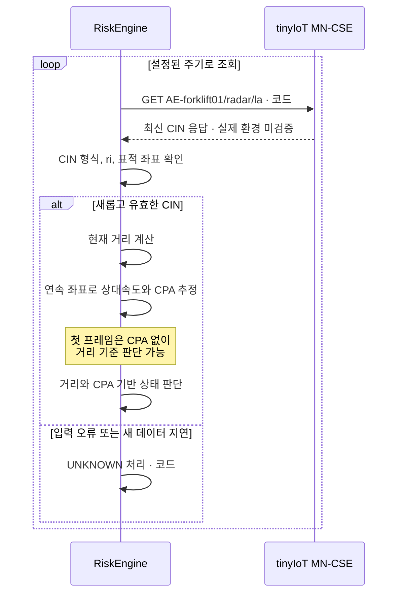
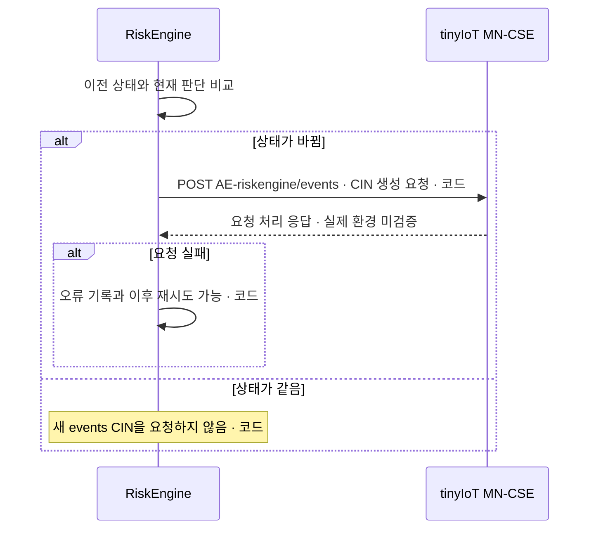
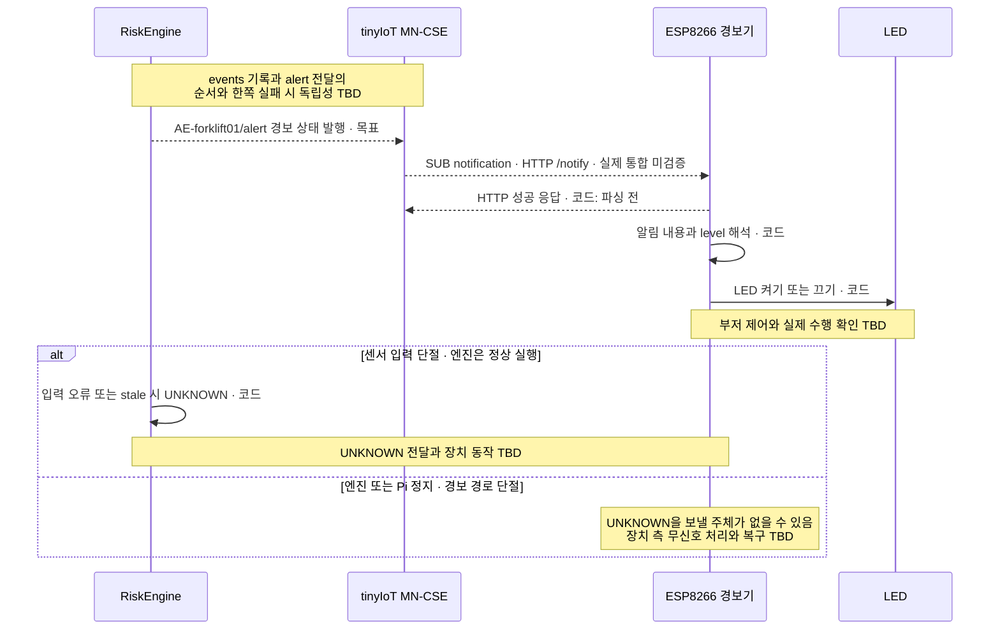

# SafeZone 아키텍처

## 문서 상태와 범위

| 항목 | 내용 |
|---|---|
| 기준 | 로컬 `main`의 `c73e62f6042ab90f27ba25fa3e2ec2bd65b8201a` 정적 조사 |
| 조사일 | 2026-11-09 |
| 한계 | Pi 설정, 실제 장비와 종단 간 동작은 확인하지 못했다. GitHub `main`이 기준 커밋과 같음은 2026-11-09 PR 생성 시 확인했다. |
| 목적 | 팀이 목표 구조와 미결정 인터페이스를 검토하고 향후 구현·검증의 기준으로 삼는다. |

SafeZone은 지게차와 작업자 사이의 위험을 감지하고 경고하는 해커톤 MVP다. 인증된 산업안전 시스템으로 취급하지 않는다. 코드 존재와 목표 설계는 실제 장비의 동작 검증을 뜻하지 않는다.

**상태 표기:** `코드`는 저장소에 구현이 있지만 실제 통합은 미검증인 항목, `목표`는 팀이 지향하는 구조, `TBD`는 결정이 필요한 항목, `미확인`은 정보나 실행 증거가 없는 항목이다. 이 문서에서는 실제 환경과 시점이 명확한 실행 증거를 확보하지 못해 관찰된 운영 경로를 확정하지 않는다.

Call flow 표에서는 같은 의미로 `구현·미검증`, `목표`, `미확인`을 사용한다. 목표 경로는 검토 대상이며 실선이나 화살표만으로 구현·실행을 주장하지 않는다. `실패 시`는 확인된 코드상 동작 또는 미발견 사실이며, 바람직한 정책을 뜻하지 않는다.

## 책임과 시스템 경계

- 레이더 노드는 지게차에 장착되는 ESP8266 + LD2450 구성을 지향한다. MQTT 브로커는 Raspberry Pi에서 실행할 계획이다. [E1, U1]
- RiskEngine은 레이더 데이터를 사용해 **최종 위험판단**을 담당한다. [E2, D1]
- Vision AI는 카메라·레이더 정보를 처리하여 판단을 위한 **조언**을 제공한다. 조언을 RiskEngine에 전달하고 반영하는 방법은 미결정이다. [E3, D1, U4]
- Pi의 tinyIoT MN-CSE, 별도 IN-CSE 및 MEC Sandbox를 활용하는 방향이다. 실제 등록, 이력 전달과 Sandbox 연동은 미확인이다. [E1, E4, U7, U8]

## 리소스 경로: 코드상 후보

다음은 코드·설정이 사용하는 경로다. `CNT` 아래에 개별 `CIN`이 만들어진다. 실제 Pi에 해당 리소스가 존재하거나 이름이 확정됐다는 뜻은 아니다. [E2, E3, E5, E7]

```text
<MN-CSE CSEBase>                         실제 이름·ID 미확인
├── AE-forklift01 [AE]
│   ├── radar [CNT] → CIN들               /la: 최신 CIN 조회
│   └── alert [CNT] → CIN들               sub-alert-node [SUB] 후보
├── AE-riskengine [AE] → events [CNT] → CIN들
├── AE-zonealarm01 [AE] → alert [CNT] → CIN들
└── AE-VisionAI [AE] → fusedTracks [CNT] → CIN들
```

Vision의 `AE-VisionAI`는 코드상의 기본 소유 AE이며 실제 등록과 팀 표준 여부는 확인이 필요하다.

## 전체 구성도

실선은 관련 코드가 확인된 연결이고 점선은 목표 또는 미결정 연결이다. **실선도 실제 통합 성공을 뜻하지 않는다.** CSE와 리소스 사이의 선은 포함 관계다. 물리적 배치 또한 목표이며 현재 Pi 상태를 보장하지 않는다.



## 핵심 Call flow

다음 네 그림은 우선 구현·검증할 경로를 설명한다. **코드**는 구현이 있으나 실제 통합은 미검증, **목표**는 팀이 지향하는 검토 대상, **TBD**는 결정이 필요한 부분이다. 화살표는 실제 장비에서의 성공을 뜻하지 않는다. 단계별 프로토콜과 실패 동작은 아래 표를 따른다.

### 1. 레이더 데이터에서 radar CIN까지

oneM2M MQTT Binding을 우선 목표로 삼는다. ESP 구현과 tinyIoT 지원은 미확인이다. 브로커는 요청을 전달하며 CIN 생성을 직접 수행하는 것으로 가정하지 않는다. [E4, U1–U3]



### 2. radar CIN에서 RiskEngine 판단까지

아래는 코드의 기본 입력 방식인 HTTP 폴링이다. HTTP notification 수신 코드도 있지만 SUB는 별도로 구성해야 한다. 실제 CSE와의 통합은 미검증이다. [E2, U2, U3]



### 3. RiskEngine 판단에서 events 이력까지

현재 엔진은 상태가 바뀌면 `AE-riskengine/events` CNT 아래에 CIN 생성을 요청한다. 실제 저장 성공과 장치 알림 성공은 별개다. [E2, U5]



### 4. 판단에서 장치 경보와 장애 대응까지

아래 경보 생성은 기존 팀 문서의 `events`와 `alert` 분리 방향을 보여주는 **목표 가설**이다. 현재 엔진의 별도 `alert` 발행은 확인되지 않았고, 최종 합의와 실제 통합도 확인이 필요하다. [E2, E5, E8, U5, U6]



현재 펌웨어의 성공 응답은 파싱이나 물리적 장치 동작의 확인이 아니다. `unknown` 값에서 LED를 끄는 현재 코드도 승인된 장애 정책으로 보지 않는다. 무신호 처리와 재부팅 후 현재 상태 복구는 아래 장애 표에서 별도 추적한다. [E5, U6]

## 구간별 상태 요약

| 구간 | 생산자 → 소비자 / 방식 | 코드·형식 및 확인 상태 |
|---|---|---|
| 레이더 → radar | ESP8266 → MQTT → MN-CSE | oneM2M MQTT Binding을 우선 목표로 검토한다. 실제 구현·지원은 미확인이며 일반 MQTT와 변환 프로그램은 대안이다. 브로커 연결만으로 CIN 생성 성공을 뜻하지 않는다. [E4, U1] |
| radar → RiskEngine | MN-CSE → RiskEngine, HTTP 폴링 또는 알림 | 기본 폴링은 `AE-forklift01/radar/la`. `con` 객체 또는 JSON 문자열을 처리하는 코드가 있다. 알림 구독은 엔진이 생성하지 않는다. 실제 데이터 호환성 미검증. [E2] |
| radar → Vision | MN-CSE → Vision, HTTP 조회 | 같은 radar 경로를 읽는 코드. Vision의 별도 업로더는 시뮬레이션 입력용이다. [E3] |
| Vision → RiskEngine | Vision → `AE-VisionAI/fusedTracks` → RiskEngine | Vision의 결과 발행 코드는 있으나 RiskEngine 소비·판단 반영은 확인되지 않았다. 전달 방식과 계약 TBD. [E3, E4, U4] |
| RiskEngine → events | RiskEngine → MN-CSE, HTTP POST | 상태 변화 때 `AE-riskengine/events`에 CIN 생성 요청. 실제 생성 결과 미확인. [E2] |
| 판단 → 경보기 | RiskEngine → 경보기 | `events`와 `alert`의 분리 여부 및 형식 TBD. 현재 엔진의 `alert` 출력은 확인되지 않았다. ESP는 `/notify`를 받는 코드가 있다. [E2, E5, U5] |
| MN-CSE → IN-CSE | CSE 간 연결 | 등록, 원격 접근, 데이터 전달·이력 저장을 각각 확인해야 한다. 등록만으로 CIN 복제를 가정하지 않는다. [E4, U7] |
| MEC ↔ oneM2M | MEC Sandbox ↔ CSE | 역할과 연결 방법 TBD. 시뮬레이션과 실제 네트워크 효과를 구분한다. [U8] |

### 우선 검토할 Call flow

| 단계 | 송신 → 수신 | 프로토콜·경로 | 메시지와 시점 | 실패 시 확인된 동작 | 상태 / 근거 |
|---|---|---|---|---|---|
| 1a 수집 | LD2450 → ESP8266 | UART 목표 | 표적 프레임; 발행·빈 프레임 주기 미확인 | 실제 ESP 처리 코드와 실패 동작 미발견 | 목표 / E1, U1–U3 |
| 1b 생성 요청 | ESP8266 → MN-CSE, 브로커 경유 | oneM2M MQTT Binding 목표; 토픽 TBD | `AE-forklift01/radar` 아래 CIN 생성 요청; 요청 ID·주기 TBD | ESP 발행 실패·재시도 구현 미발견 | 목표 / E4, U1 |
| 1c 생성 응답 | MN-CSE → ESP8266, 브로커 경유 | MQTT 응답 토픽 TBD | 요청 `rqi`와 응답 상태 상관관계 확인 | ESP 응답 처리·타임아웃 구현 미발견 | 목표 / E4, U1 |
| 2a 폴링 | RiskEngine → MN-CSE → RiskEngine | HTTP GET `AE-forklift01/radar/la` | 기본 입력 방식; `ri`와 `con.targets` 처리 | 조회 예외·형식 오류·`ri` 누락 시 UNKNOWN 처리; 같은 `ri`는 중복으로 취급 | 구현·미검증 / E2 |
| 2b 알림 | MN-CSE → RiskEngine | HTTP POST `/notify`; SUB 별도 설정 필요 | verification 또는 CIN 알림; 엔진은 SUB 미생성 | 처리 예외 시 UNKNOWN 기록 시도 후 HTTP 200 응답 | 구현·미검증 / E2 |
| 2c 판단 | RiskEngine 내부 | 함수 호출 | 거리와 연속 좌표 기반 CPA | 입력 전·오류·stale은 UNKNOWN. 최초 프레임은 속도·CPA가 없어도 거리 기준 상태를 낼 수 있음 | 구현·미검증 / E2 |
| 5 이력 | RiskEngine → MN-CSE | HTTP POST `AE-riskengine/events` | 상태가 바뀌면 CIN 생성 요청 | 실패 로그를 남기고 마지막 발행 상태를 갱신하지 않아 이후 재시도 가능 | 구현·미검증 / E2 |
| 6a 경보 생성 | RiskEngine → MN-CSE 또는 장치 | `events` 재사용 또는 별도 `AE-forklift01/alert` TBD | 장치용 상태·유효 기간·기록과의 순서 TBD | 엔진의 별도 alert 발행과 기록·경보 독립 처리 구현은 조사 범위 내 미발견 | 미확인 / E2, E8, U5 |
| 6b 알림 수신 | MN-CSE → ESP8266 | 스크립트의 `nu`: HTTP `/notify` | SUB 검증 또는 CIN 알림 | 펌웨어는 내용 파싱 전에 HTTP 200을 응답하고 파싱 실패 시 반환. 실제 연동 미검증 | 구현·미검증 / E5 |
| 6c 장치 출력 | ESP8266 → LED | 로컬 GPIO | `danger`·`warn`이면 켜고 그 외 값이면 끔 | 무신호 타임아웃·물리적 수행 확인은 조사 범위 내 미발견 | 구현·미검증 / E5, U6 |

`ri` 중복 확인은 이전에 처리한 ID와의 비교이며 순서 역전 방지를 보장하지 않는다. 표적은 `slot`, 없으면 `id`, 그것도 없으면 배열 순번으로 연결한다. 지속적인 사람 ID로 보장되지 않으며, 센서가 장착된 지게차를 좌표 기준으로 삼는 가정과 작업자 판별도 검증이 필요하다. [E2, U2–U4]

알림의 성공 응답은 장치가 내용을 해석하거나 물리적으로 경보를 수행했다는 확인이 아니다. 위 펌웨어는 `unknown`에도 LED를 끄는데, 이는 **현재 코드상 동작이며 승인된 장애 정책이 아니다.** 부저 동작과 출력 확인 신호는 해당 펌웨어에서 확인하지 못했다. [E5]

### 장애 상황: 여러 흐름에 걸친 확인 항목

| 장애 | 현재 코드에서 확인되는 동작 또는 공백 | 관련 구간 |
|---|---|---|
| 센서 → CSE 단절 | 엔진이 살아 있고 새 CIN이 없으면 stale UNKNOWN. ESP 쪽 실패 처리는 미확인. | 1, 2 |
| CSE → RiskEngine 단절·지연 | 조회 예외 또는 새 CIN 부재 시 UNKNOWN 코드. 순서 역전 감지는 확인하지 못함. | 2 |
| RiskEngine 또는 Pi 정지 | 멈춘 엔진은 UNKNOWN을 발행할 수 없음. | 2, 5, 6 |
| RiskEngine → 경보기 단절 | 장치 측 무신호 타임아웃은 확인하지 못함. 마지막 출력이 유지될 수 있음. | 6 |
| 경보기 전원 차단·재부팅 | 펌웨어는 시작 시 LED를 끔. 현재 상태 재조회·복원은 확인하지 못함. | 6 |

메시지 유실 뒤 장치가 마지막 이벤트를 유지할지 현재 상태를 복구할지, 메시지 유효 기간, 장치의 수행 확인, 이력 기록과 경보 전달의 순서 및 한쪽 실패 시 독립성은 팀 결정이 필요하다. CIN을 이력이나 상태 기록 중 어떻게 활용할지는 애플리케이션 계약에 달려 있다. [U5, U6]

Vision의 입력·출력은 코드가 있으나 엔진의 조언 소비와 Vision 장애 시 레이더 경로 독립성은 미확인이다. MEC는 운영 경로와 분리된 목표 시나리오로 검토한다. 로컬 인터락은 기존 구상이며 구현 범위와 경보 경로 간 우선순위·충돌 중재는 TBD다. [E1, E3, U4, U8]

## 기존 코드와 목표의 차이

RiskEngine은 거리와 연속 좌표 기반 상대 움직임을 사용해 `SAFE`, `WARNING`, `DANGER`, `UNKNOWN`을 판단한다. 센서 `ts`는 메타데이터로 보존하며 신선도 판단에 쓰지 않는다. 새 CIN이 일정 시간 오지 않으면 `UNKNOWN`으로 처리한다. 빈 프레임의 실제 전송 여부는 미확인이다. [E2, U2, U3]

제조사 원시 프레임의 x/y는 mm, 속도는 cm/s이며 소비자 코드도 `radar` CIN이 같은 단위라고 가정한다. Vision은 내부 계산과 `fusedTracks`에서 좌표를 m로 사용하므로, 두 리소스의 같은 `x`, `y` 필드를 혼동하지 않아야 한다. 실제 ESP가 보낼 CIN 단위는 검증하지 못했다. [E2, E3, E9]

LD2450 출력 프레임에 timestamp는 명시되지 않는다. 레이더 `ts`의 생성 주체·기록 시점·동기화는 미정이며 실제 시간 동기화 장애는 확인되지 않았다. RiskEngine은 센서 `ts` 대신 자체 단조 시계의 수신 시각으로 속도와 신선도를 계산한다. Vision의 단순 TTC와 엔진의 2차원 CPA는 서로 다른 계산이며 충돌 시각으로 동일시하지 않는다. [E2, E3, E9, U3]

기존 `radar/radar_node.py`는 Pi 직렬 포트를 읽고 HTTP `/on`·`/off`를 호출한다. 현재 `alert_node.ino`는 `/notify`를 등록한다. 이 두 파일을 그대로 연결하면 경로가 다르며 실제 사용 조합은 미확인이다. 커밋되지 않은 `radar/cin_uploader.py`와 `radar/CIN_UPLOADER.md`는 ESP8266 + MQTT의 확정 구현으로 취급하지 않는다. [E5, E6]

기존 README의 장비 동작부·로컬 인터락·대시보드는 구상으로 표시한다. 실제 구현과 이번 마일스톤의 포함 범위는 팀 확인이 필요하다. [E1]

## 결정·검증 현황과 잠정 전제

문제 발생 시 ID를 이용해 관련 흐름·결정·검증 기록을 함께 추적한다. 실측 전에는 코드상 가정을 실제 센서의 계약으로 확정하지 않는다.

| ID | 전제·결정 항목 / 상태 | 전제가 틀릴 때 나타날 수 있는 현상 | 확인 방법 / 담당 분야 |
|---|---|---|---|
| U1 | oneM2M MQTT Binding **우선 목표**, 실제 구현·지원 미확인 | MQTT는 연결되지만 `radar/la`가 갱신되지 않음 | 토픽·요청·응답·CSE ID·권한·CIN 조회 확인 / 레이더·플랫폼 |
| U2 | 제조사 원시 좌표 mm·속도 cm/s와 소비자 가정은 일치, 실제 CIN은 **미검증** | 거리나 접근 방향을 잘못 판단 | 실제 프레임과 실측 거리, 축·설치 방향, 속도 의미·부호 / 레이더·엔진·Vision [E9] |
| U3 | timestamp·표적 슬롯·빈 프레임 계약 **미확인** | 잘못된 속도 추정, 지속적 UNKNOWN, 잘못된 상태 복귀 | 시간 기록 시점, 슬롯 유지, 빈 프레임과 CIN 주기 / 레이더·엔진 |
| U4 | Vision 조언 전달·반영 규칙 **TBD** | 오래된 조언이나 다른 표적의 조언을 사용 | 스키마, 좌표계, 표적 연결, 유효 시간, 누락·충돌 처리 / Vision·엔진 |
| U5 | `events`와 `alert`의 분리·통합 **TBD** | 기록은 있으나 경보기 무반응 또는 중복 경보 | 리소스·구독 경로, 형식, 발행·수신 응답 / 엔진·장치·플랫폼 |
| U6 | UNKNOWN·단절·전달 실패 시 장치 동작 **TBD** | 마지막 상태가 지속되거나 위험 여부를 알 수 없음 | 장치 표시, 유효 시간, 재시도·재시작·재연결 정책 / 엔진·장치 |
| U7 | MN → IN 이력 전달 방식 **TBD** | MN에는 기록이 있으나 IN에는 없음 | CSE 등록, 접근 권한, 전달 및 IN 조회를 각각 확인 / 플랫폼 |
| U8 | MEC Sandbox 역할·연동 **TBD** | 시뮬레이션을 실제 연동으로 오인 | 입출력, oneM2M 접점과 시험 환경 / MEC·플랫폼 |
| U9 | 저장소 CSE 이름과 권한 설정의 Pi 적용 여부 **미확인** | 경로 조회 실패 또는 권한 오류 | 실제 CSEBase 이름·ID, AE/CNT/SUB/ACP와 클라이언트 설정 / 플랫폼 |
| D1 | RiskEngine 최종 판단, Vision 조언 제공 **팀 방향** | 책임 경계가 불명확해 다른 구성요소가 상충하는 제어를 내림 | 인터페이스와 판단 우선순위를 구체화 / 엔진·Vision |

## 팀 결정: events와 alert

현재 RiskEngine은 상태 변화 시 `events`에 판단 이력 CIN을 생성하도록 요청한다. 장치용 `alert` 발행 코드는 확인되지 않았다. [E2]

| 선택지 | 장점 | 비용·위험 |
|---|---|---|
| **분리**: `events`는 판단 이력, `alert`는 장치용 경보 상태 | 이력과 장치 메시지의 목적·형식을 독립적으로 관리하기 쉽다. | 발행 경로가 늘고 한쪽만 성공할 수 있어 오류 기록·재시도 설계가 필요하다. |
| **통합**: 경보기가 `events`를 구독 | 별도 `alert` 발행 없이 MVP를 단순화할 수 있다. | 이력과 장치가 같은 형식에 의존하고, 장치별 정책이나 스키마 변경의 영향을 함께 고려해야 한다. |

**기존 팀 설계 기록: 분리. 현재 최종 합의와 구현은 확인이 필요하다.** Vision 문서에 2026-11-05 두 경로를 사용한다는 팀 설계 기록이 있다. [E8] 어느 쪽이든 CIN 생성 성공은 알림 수신이나 실제 LED·부저 동작 성공을 보장하지 않는다. 현재처럼 상태가 바뀔 때만 발행하면 메시지 누락·장치 재시작 후 현재 상태 복구도 결정해야 한다. [U5, U6]

## 검증 계획

1. 실제 레이더 프레임으로 단위·방향·시간·슬롯·빈 프레임을 확인한다. [U2, U3]
2. MQTT 요청·응답과 `radar/la` 생성 여부를 각각 확인한다. [U1]
3. 실제 radar 입력, RiskEngine 판단 및 events CIN 생성을 단계별로 확인한다. [E2]
4. Vision 조언 계약을 정하고 RiskEngine의 수신과 반영을 확인한다. [U4]
5. 경보 발행, 알림 수신, 실제 장치 동작과 장애 복구를 각각 검증한다. [U5, U6]
6. CSE 간 등록·전달과 MEC Sandbox 연동을 별도로 검증한다. [U7, U8]

검증 기록에는 일시, commit, 장비·환경, 절차, 결과와 로그 출처를 남기고 모의 시험과 실제 장비 시험을 구분한다.

## 근거

다음은 로컬 `main` `c73e62f`의 코드·문서이며 별도 명시가 없는 한 실행 증거가 아니다. 현재 GitHub 상태나 실제 장비 동작을 입증하지 않는다.

| ID | 출처 | 확인 범위 |
|---|---|---|
| E1 | [README.md](../README.md) | 기존 목표 구성과 리소스 구상 |
| E2 | [engine/README.md](../engine/README.md), [engine/main.py](../engine/main.py), [engine/onem2m_http.py](../engine/onem2m_http.py) | 엔진 입력·판단·이벤트 생성 요청 코드와 가정 |
| E3 | [vision/config.yaml](../vision/config.yaml), [vision main](../vision/src/vision4iot/main.py), [radar uploader](../vision/src/vision4iot/radar_uploader.py) | Vision 입력·출력과 시뮬레이션 업로더 |
| E4 | [docs/cse-naming.md](cse-naming.md) | 이름 제안과 통합 미검증 기록 |
| E5 | [alert_node.ino](../esp8266/led_server/alert_node.ino), [sub_alert_node.sh](../onem2m/sub_alert_node.sh) | 알림 수신 펌웨어와 구독 스크립트 |
| E6 | [radar/radar_node.py](../radar/radar_node.py) | Pi 직렬 입력과 HTTP 장치 요청 코드 |
| E7 | [onem2m/setup_onem2m.sh](../onem2m/setup_onem2m.sh), [Vision publisher](../vision/src/vision4iot/publisher.py) | 코드상의 AE·CNT 생성 경로 |
| E8 | [vision/CLAUDE.md](../vision/CLAUDE.md) 2장 | 2026-11-05 events와 alert 분리 팀 설계 기록; 현재 전체 합의·구현 증거는 아님 |
| E9 | [Hi-Link LD2450 직렬 통신 프로토콜 v1.03](https://h.hlktech.com/download/HLK-LD2450-24G/1/LD2450%20%E4%B8%B2%E5%8F%A3%E9%80%9A%E4%BF%A1%E5%8D%8F%E8%AE%AE%20V1.03.pdf), 2.3절 | 원시 좌표 mm, 속도 cm/s와 프레임 구성 |

팀 방향 D1 및 MQTT 브로커 배치·마일스톤은 사용자와의 설계 논의를 바탕으로 한 목표이며 실행 검증을 뜻하지 않는다.
