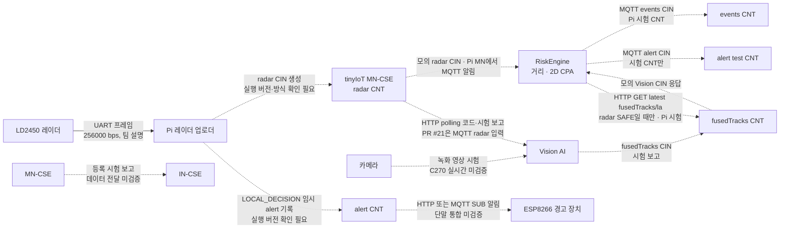
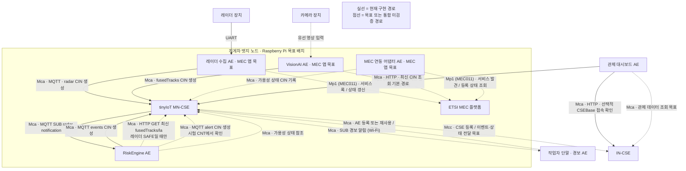
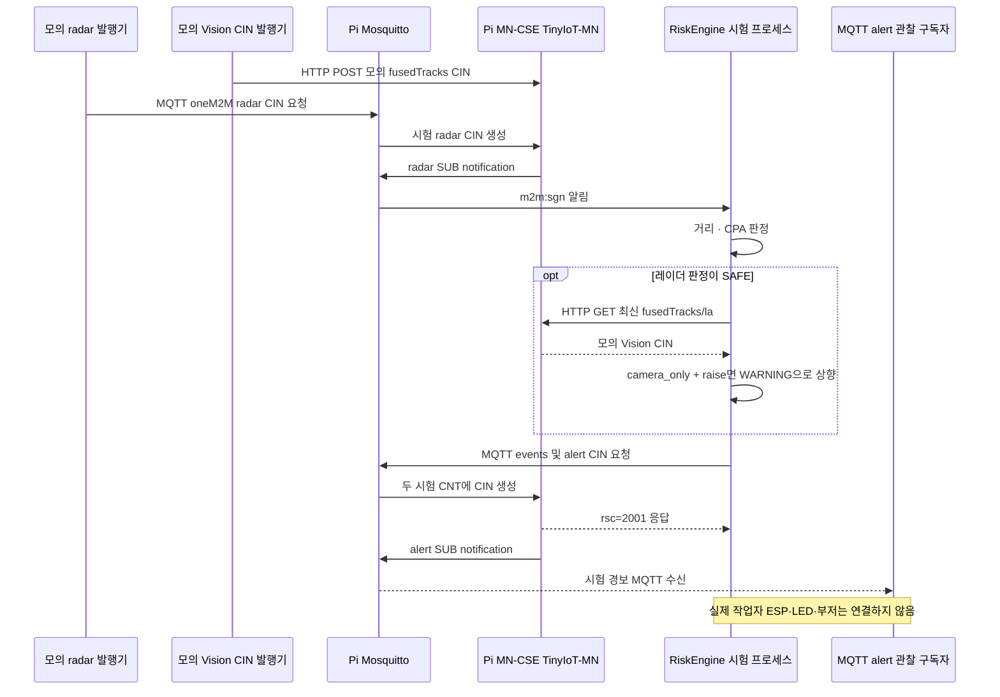
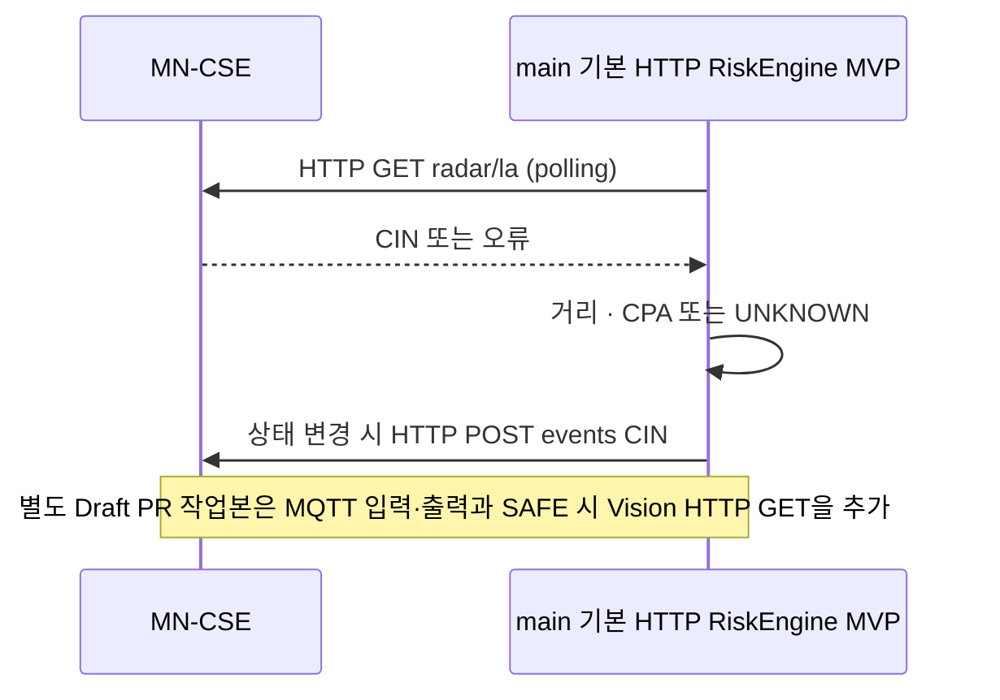

# SafeZone 아키텍처와 통합 상태

## 문서 범위

팀 공유 정보, GitHub 코드와 별도 시험 결과를 정리한다. 목표 구성, 관제 경로와 아래 통합 기록을 2026-11-17에 다시 대조했다. **현재 프로토타입**, **코드·모의 시험**, **미검증 목표**는 서로 다르다. 각 시험의 서버·DB와 데이터 출처를 확인하고, 단일 시험 결과로 실제 장비 전체 연동이나 산업안전 성능을 주장하지 않는다.

- 저장소 기준: [Draft PR #14](https://github.com/extra-7ex/Sejong_4IoT_OneM2M/pull/14)는 RiskEngine MQTT radar 알림 입력과 `events` 기록의 기반이다. 이 문서의 Pi 검증과 `alert`·Vision 조언 코드 변경은 별도 Draft PR로 제안하며, #14나 `main`에 직접 푸시하지 않는다.
- [Vision MQTT 입력 PR #21](https://github.com/extra-7ex/Sejong_4IoT_OneM2M/pull/21)은 VisionAI가 레이더 알림을 받는 경로다. RiskEngine의 fusedTracks 접근은 아래 Pi 시험에서 별도로 검증한 HTTP GET이며, #21의 레이더 입력 경로와 혼동하지 않는다.
- MEC 작업은 [실험 PR #16](https://github.com/extra-7ex/Sejong_4IoT_OneM2M/pull/16), [연동 AE PR #18](https://github.com/extra-7ex/Sejong_4IoT_OneM2M/pull/18), [Pi MN 시험 PR #19](https://github.com/extra-7ex/Sejong_4IoT_OneM2M/pull/19)에서 이어진다. 각각의 테스트 범위와 미검증 항목은 해당 PR에 한정한다.
- 현태의 설명: LD2450은 Pi UART에 직접 연결되어 있으며 ESP8266은 레이더와 직접 연결하지 않고 tinyIoT의 HTTP 알림을 받는다. 장비별 현재 펌웨어·동작은 재확인이 필요하다.
- 광민의 보고: Pi MN과 노트북 IN의 연결 시험 성공. 다른 시험에서는 Pi 내부 IN도 사용했다. CSE 등록과 `events`의 IN 전달은 별도 검증이다.
- [Vision PR #9](https://github.com/extra-7ex/Sejong_4IoT_OneM2M/pull/9): 실제 radar CIN 예시를 Vision이 읽었고, MQTT·HTTP 입력/출력과 녹화 영상으로 시험했다고 보고했다. PR은 작성 당시 열린 상태였으며 해당 보고의 전체 재현 여부는 별도 기록한다.

## 현재 프로토타입과 목표

### 현재 확인된 배치



점선은 특정 코드·시험 환경·목표 중 하나에 한정되며, 실제 전체 통합을 의미하지 않는다. `radar`, `events`, `fusedTracks`, `alert`는 MN-CSE 아래 CNT다. 현재 확인된 레이더 배선은 **LD2450 → Pi UART**다. ESP8266이 직접 radar를 읽는 구성은 과거 목표안이며 현재 배선으로 단정하지 않는다.

### 표준 엔티티와 목표 배치

센서 장치는 Pi의 수집 앱에 연결된다. 수집 앱의 oneM2M AE가 센서 데이터를 MN-CSE에 기록한다. MEC 플랫폼은 같은 Pi에 배치해 서비스 발견과 가용성 관리에 사용한다. Pi에서 두 플랫폼의 동시 실행은 미검증이다. 상위 그림은 관제 서버를 oneM2M 관점의 AE로 표시하며, 브라우저는 서버의 HTTP API를 사용한다.



실선은 코드에 있는 경로를 뜻하며, 실제 Pi·센서·단말을 연결한 통합 시험 결과는 아래에 따로 기록한다. PR #14의 RiskEngine 작업본은 radar MQTT notification 입력과 MQTT `events` 출력을 제공한다. 별도 엔진 변경은 SAFE 판정에서만 `fusedTracks/la`를 HTTP GET하고, `events`·`alert`를 MQTT로 쓰는 혼합 경로를 Pi 시험 CNT에서 확인했다. 레이더·Vision 데이터는 모의였고 작업자 단말은 연결하지 않았다. 저장소에는 HTTP와 MQTT 경보 수신 코드가 모두 있으므로 작업자 단말의 실제 SUB 바인딩은 설치 펌웨어와 함께 확인한다.

#### 등록 및 리소스 사전조건

- **MN-CSE**에 쓰거나 구독하는 AE는 등록 또는 기존 등록을 재사용하고, 해당 CNT와 접근 권한을 준비한다. MQTT radar 알림 시험과 작업자 경보 목표에는 각각 별도 SUB와 알림 수신 주소가 필요하다.
- **IN-CSE** 경유 관제를 구성하려면 MN-CSE 등록과 관제 AE의 조회 권한을 확인한다. 이벤트·상태를 IN에 보관할지, IN을 경유해 MN 리소스를 조회할지 결정하고 실제 조회로 검증한다.
- **MEC 플랫폼**에서 앱 배치·등록과 서비스 등록을 각각 확인한다. 레이더 수집과 VisionAI의 제공 서비스, 어댑터의 발견 권한과 실제 점검 대상은 별도로 정의한다. [ETSI GS MEC 011 §5](https://www.etsi.org/deliver/etsi_gs/MEC/001_099/011/03.03.01_60/gs_MEC011v030301p.pdf)

#### 관제 경로 확인

[main의 대시보드 서버](https://github.com/extra-7ex/Sejong_4IoT_OneM2M/blob/e851fbf8ea7407f7614512da73b7fdf3dd30513d/dashboard/server.py)는 기본적으로 `DASH_CSE_BASE`의 `TinyIoT-MN`에서 `radar`, `events`, `fusedTracks`, `alert`의 최신 CIN을 읽는다. 선택 설정 `DASH_IN_BASE`는 CSEBase 접속 확인용이다. 서버는 기본 `CAdmin`으로 GET 요청을 보내며 자체 AE 등록을 수행하지 않는다. 브라우저는 대시보드 서버의 `/api/*`를 조회한다.

IN을 데이터 원본으로 쓰려면 선택한 전달 방식과 각 활성 조회 경로에서 실제 CIN을 읽을 수 있는지 확인해야 한다. 기본 서버는 네 가지 경로를 같은 `DASH_CSE_BASE`에 요청하므로 events 하나만 IN에 제공하면 나머지 경로의 데이터는 별도로 구성해야 한다. [대시보드 PR #12](https://github.com/extra-7ex/Sejong_4IoT_OneM2M/pull/12)의 시험 보고 범위는 가짜 CSE이며 실제 Pi 통합은 미확인이다.

#### MEC 가용성 확인 기준

| 확인 지점 | 확인할 내용 |
|---|---|
| 서비스 등록부 | 어댑터가 Mp1로 레이더 수집·Vision 서비스를 각각 발견하고 등록 상태를 읽는다. |
| 실제 입력 | 두 생산 앱을 하나씩 중단해 등록 상태와 실제 API 응답·최신 입력 시각을 각각 확인한다. 감지 주체, heartbeat/health check, 상태 갱신 방식은 미정이다. |
| RiskEngine 목표 동작 | Vision이 끊겨도 신선한 레이더가 있으면 레이더 판단을 유지한다. 레이더가 끊기거나 오래되면 UNKNOWN으로 처리한다. 유효한 빈 레이더 프레임은 정상 입력이다. |

[PR #16](https://github.com/extra-7ex/Sejong_4IoT_OneM2M/pull/16)의 격리 환경에서는 모의 Vision의 등록·발견·호출을 시험했다. 모의 서비스를 멈췄을 때 호출은 실패했지만 등록부에 ACTIVE가 남았다. 실제 장비에서 장애 감지 주체와 상태 전달 방식이 정해지면, 장애 감지 → 상태 기록 → 판정 전환을 별도 호출 흐름으로 기록한다.

아래 Pi 시험은 PR #14의 MQTT 입력·`events` 작업본을 기반으로 하며, 그 위에 `alert` 출력과 Vision 조언을 붙인 별도 Draft PR 변경을 사용했다. 여러 지게차 MN과 작업자 AE가 연결되는 구성은 확장 시나리오이며, 작업자와 레이더 표적의 매핑은 미정이다.

### MQTT 통합 시험의 흐름

2026-11-17 Pi ARM64의 실제 MN-CSE와 Mosquitto에서 확인했다. 모든 기록은 운영과 분리된 시험 CNT에 썼고, radar와 Vision CIN은 모의 데이터였다. 시험 전용 ACP로 RiskEngine의 fusedTracks 조회 권한을 확인했으며, alert 알림은 ESP가 아닌 MQTT 관찰 구독자로 받았다.



시험 결과는 SAFE + 신선한 `camera_only + raise` → WARNING, 신선한 raise 없음 → SAFE, CPA WARNING(`t_cpa_s=2.5936`, `d_cpa_m=0`) → CPA DANGER(`t_cpa_s=0.9113`, `d_cpa_m=0`), 입력 만료 → UNKNOWN이다. `events`와 `alert` 생성 응답은 `rsc=2001`이었고, 별도 관찰 구독자가 alert MQTT 알림을 받았다. alert의 기존 `ttc` 필드는 `null`이며 CPA 값은 `events`에 기록된다. 실제 LD2450 업로더, VisionAI 실제 출력, 작업자 ESP와 부저, 운영 ACP는 미검증이다. 사용한 tinyIoT는 SUB 검증 알림에 수신 애플리케이션 응답이 없는데도 SUB를 생성했다. **검증 응답 구현과 다른 tinyIoT 버전의 호환성은 미확인**이다.

### RiskEngine MVP의 HTTP 입출력



### 별도 장치 경보 경로

`main`의 레이더 업로더는 `LOCAL_DECISION=True`일 때 `AE-forklift01/alert`에 임시 경보를 기록한다. RiskEngine MVP의 출력은 `events`다. MN-CSE가 alert 구독을 통해 작업자 단말로 보내는 HTTP·MQTT 수신 코드와 SUB 스크립트가 있다. 실제 설치 펌웨어, 구독 설정, CIN 수신 및 LED·부저 동작을 각각 확인한다. HTTP 구현은 파싱 전에 응답을 보내므로 LED와 부저는 장치에서 별도로 확인한다.

## 리소스와 책임

```text
<TinyIoT-MN>                              # 팀 제안; 실제 서비스별 응답 확인
├─ AE-forklift01 (Cforklift01)
│  ├─ radar       [CNT]                   # radar CIN
│  └─ alert       [CNT]                   # 장치용 경고; 작성 주체·정책 확인
├─ AE-riskengine (Criskengine)
│  └─ events      [CNT]                   # 위험 판단 이력
├─ AE-VisionAI (CVisionAI)
│  └─ fusedTracks [CNT]                   # Vision 융합 결과
├─ AE-zonealarm01
│  └─ alert       [CNT]                   # 목표·실제 연결 미검증
└─ AE-camera01
   └─ detect      [CNT]                   # 기존 구상; Vision 경로와 역할 확인
```

`radar`에는 대상이 최대 3개인 CIN을 저장한다. 현재 `main`의 RiskEngine MVP는 `events`를 작성하고 별도 `alert`는 작성하지 않지만, #14를 기반으로 한 이 엔진 Draft PR은 시험용 alert CNT 기록과 MQTT SUB 알림을 확인했다. 현재 `main`의 레이더 업로더는 `LOCAL_DECISION=True`가 기본이다. 실제 작업자 경보 경로로 전환하기 전까지 운영 alert CNT의 작성자는 한 번에 하나로 유지한다.

Vision은 `AE-VisionAI/fusedTracks`에 결과를 기록하는 코드가 있다. 이 엔진 Draft PR은 레이더 판정이 SAFE일 때 최신 fusedTracks CIN을 HTTP GET하고, 신선한 `cam_ok=true`, `radar_ok=true` 결과의 `camera_only + raise`만 WARNING으로 올린다. Pi 모의 시험은 `radar_ok` 필수 조건을 추가하기 전에 수행했으며, 변경된 조건과 실제 VisionAI 생산자 연결, 작업자 식별 매핑은 미검증이다. Vision의 `ghost_suspect`를 사람 부재의 확정으로 취급하지 않는다.

## 통신과 시험 결과

| 구간 | 확인된 내용 | 남은 확인 |
|---|---|---|
| LD2450 → Pi | UART 직접 연결은 현태의 설명. 실제 현장 전체 연결 시험으로 확대 해석하지 않는다. | 실제 배선·작동 중 업로더 버전·CIN 연속 기록 |
| radar → MN | `main`의 Pi 업로더는 기본 MQTT로 발행하며 유효한 빈 프레임도 업로드를 시도한다. MQTT 생성·HTTP 조회의 Pi 시험은 팀 보고다. | 실제 설치 버전, MQTT 응답, 빈 CIN 도착과 전송 주기 |
| radar → RiskEngine → events | Pi ARM64의 실제 MN-CSE·Mosquitto와 별도 CNT에서 모의 radar CIN → MQTT SUB 알림 → 거리·CPA 판정 → MQTT events CIN을 시험했다. 생성 응답 `rsc=2001`과 CIN 조회를 확인했다. | LD2450 업로더에서 생성한 실제 CIN·연속 전송, 실제 입력 주기와 stale 설정 |
| MQTT notification → RiskEngine → events | PR #14의 MQTT 입력·events 작업본을 기반으로 Pi 시험을 다시 했다. SUB 알림 처리와 MQTT events 생성 응답·저장을 확인했다. | 표준 SUB 검증 응답, 재접속·복구 및 다른 tinyIoT 버전 호환 |
| Vision | PR #9·#21은 Vision 입력과 MQTT radar 입력을 다룬다. RiskEngine은 Pi의 별도 CNT에 넣은 모의 fusedTracks를 SAFE 판정 때 HTTP GET했다. `camera_only + raise`의 WARNING 상향과 raise 없는 SAFE 유지를 확인했다. | VisionAI 실제 fusedTracks 생성·신선도·표적 연결을 RiskEngine에 연동 |
| MN ↔ IN | Pi MN과 노트북 IN의 CSE 연결 성공이 보고됐다. 별도 Pi 내부 IN 시험도 보고됐다. | 어떤 서버·이름·ID인지와 등록, 원격 조회, 실제 `events` 전달을 각각 검증 |
| MN/IN → 관제 | 대시보드는 기본 MN 최신 CIN 조회와 선택적 IN 접속 확인을 구현한다. 가짜 CSE 기반 단위 테스트 4개를 확인했다. | 실제 Pi 데이터 조회, IN을 통한 관제 데이터 조회 |
| MEC 서비스 발견 및 가용성 | PR #16에서 모의 Vision 등록·발견·호출을 시험했다. 중단 후 등록 상태는 ACTIVE로 남았다. | 실제 레이더·Vision의 장애 감지, 상태 CIN 기록과 판정 전환 |
| alert → ESP | RiskEngine의 MQTT alert CIN을 Pi 시험 CNT에 기록하고, MQTT 관찰 구독자가 SUB 알림을 받았다. | 설치 펌웨어의 SUB/nu, 실제 ESP CIN 수신, LED·부저 동작 및 운영 ACP |

상희의 MQTT 시험 보고는 RAM에 둔 DB 복사본에서 330건 중 325건의 생성 성공 응답을 확인했다. 5건의 실패 또는 응답 누락 원인은 미확인이다. 같은 보고의 SD카드 DB 약 1.6초/건은 별도 환경의 관찰이며 일반적인 지연 또는 성능 보장값이 아니다. 1초 데이터 만료 기준과 실제 CIN 수신 간격은 재측정이 필요하다.

## 좌표·시간과 위험 판단

- radar CIN의 x·y는 mm, v는 cm/s라는 코드·시험 가정이 있다. `slot`을 포함하는 실제 CIN 예시가 보고됐지만, 다중 표적 교차·가림·소실 시 슬롯 유지와 재사용은 미검증이다.
- Vision의 fusedTracks x·y·`dist_m`은 m, `ttc_s`는 초라는 현재 코드 가정이다. 실제 설치 시 센서의 원점·축 방향·보정과 시간 기준을 확인한다.
- RiskEngine은 현재 거리와 같은 표적으로 연결한 연속 좌표의 변화로 상대속도·2D CPA를 계산한다. `t_cpa`는 최근접 시각이지 위험 반경에 처음 들어가는 시각이 아니며, 현재 속도 유지 조건의 예측이다. Vision의 거리/접근속도 `ttc_s`와 동일시하지 않는다.
- 위험 반경·거리·시간 임계값은 시험 가설이다. 센서 오차, 회전하는 레이더 좌표계, 센서 설치 오프셋 및 지게차 실제 크기는 추가 검토가 필요하다.
- 기존 GitHub MVP는 시작 시 오래된 `radar/la`를 새 입력으로 받아들일 수 있다. 별도 엔진 작업본은 첫 CIN을 기준점으로 기억하고 다음 CIN을 기다린다. 현재 Pi 업로더는 유효한 빈 프레임도 전송을 시도한다. 실제 MN에 빈 CIN이 계속 도착하는지, 프레임 중단 시 UNKNOWN으로 전환하는지 확인한다.

## 실패와 장애 처리

| 상황 | 현재 확인 및 미결 사항 |
|---|---|
| 입력 누락·오래된 CIN | 엔진의 기존 stale 정책은 UNKNOWN이다. 최근 별도 작업본의 최초 CIN 보류 정책은 실제 장비 미검증. |
| MN → IN 연결 실패 | 기존 MN 코드에는 시작 시 IN 등록 실패로 부팅이 중단되는 경로가 있다. IN 장애 중 MEC 로컬 기능 유지와 재연결은 팀 논의 중이다. 독립 시험에서는 등록을 생략했으므로 이 정책을 검증하지 않았다. |
| 통지 확인·재전송 | MQTT 시험 tinyIoT는 직접 `m2m:sgn` 형태의 검증 알림을 발행했고 별도 수신 응답 없이 SUB를 생성했다. 표준적인 검증 응답 처리, 중복·유실·재연결은 추가 검증이 필요하다. |
| 이벤트 저장 지연·timeout | 응답 timeout 뒤에도 CIN이 생성된 사례가 있다. 중복 방지와 저장 여부 확인, 재처리 정책이 필요하다. |
| MEC 서비스 장애 | 등록 상태와 실제 API 응답·입력 신선도를 각각 확인한다. Vision 중단 시 신선한 레이더로 판단을 유지하는 목표 동작과 상태 전달은 실장비 미검증이다. |
| RiskEngine·Pi·Wi-Fi 장애 | 엔진이 멈추면 새 판정을 기록할 수 없다. 장치 측 무신호 동작, 별도 인터락, 통신 복구 및 재가동은 미확정이다. |

`LOCAL_DECISION`은 레이더 노드의 임시 alert 작성 로직이며, 네트워크에 의존하지 않는 직접 모터 정지 인터락의 구현·검증 근거가 아니다. 기존 ESP 펌웨어의 `warn`/`danger` 이외 표시 및 부팅 시 LED 동작도 합의된 안전 정책이 아니다.

## 우선 확인할 인터페이스

1. 현태·태양: 실제 UART 업로더의 코드 버전, CIN `slot`·좌표·속도·timestamp, 빈 프레임 전송 주기, alert 작성 주체 확인.
2. 광민·태양: 실제 서비스의 CSEBase `rn`/`ri`/`csi`, 서버·DB, MQTT 토픽·oneM2M 응답·ACP, IN 등록과 이력 전달 분리 검증.
3. 상희·태양: 실제 fusedTracks CIN의 단위·원점·축·ID·신선도 및 판정 반영 여부 확인. slot이 없을 때 Vision과 엔진의 대체 ID 규칙은 현재 차이가 있다.
4. 팀 공통: UNKNOWN, 장치 경고, 연결 장애·복구, 로컬 인터락과 재가동의 기준을 결정하고 실제 장비에서 검증.

## 근거와 기록

- [프로젝트 README](../README.md): 기존 구상, 현재 UART 배선 표와 목표 배선.
- [RiskEngine README](../engine/README.md) 및 [RiskEngine 코드](../engine/risk_engine.py): 현재 저장소 MVP의 거리·CPA와 전제.
- [Vision 코드](../vision/src/vision4iot/main.py), [Vision 설계](../vision/CLAUDE.md), [Vision PR #9](https://github.com/extra-7ex/Sejong_4IoT_OneM2M/pull/9): Vision 입출력과 시험 보고.
- [CSE 명명안](cse-naming.md): 제안 이름과 전환 시 고려사항.
- [이슈 #7](https://github.com/extra-7ex/Sejong_4IoT_OneM2M/issues/7), [이슈 #8](https://github.com/extra-7ex/Sejong_4IoT_OneM2M/issues/8): 독립 MN 및 Vision 모의 연동 기록. 각 이슈의 시점과 환경에 한정한다.
- 현태·광민의 배선 및 서버 시험 설명은 팀 전달 내용이다. 코드 존재, 담당자 보고와 독립적인 실장비 재현 결과를 구별한다.
