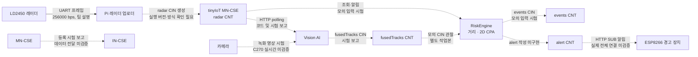
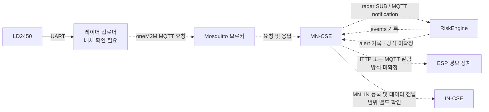
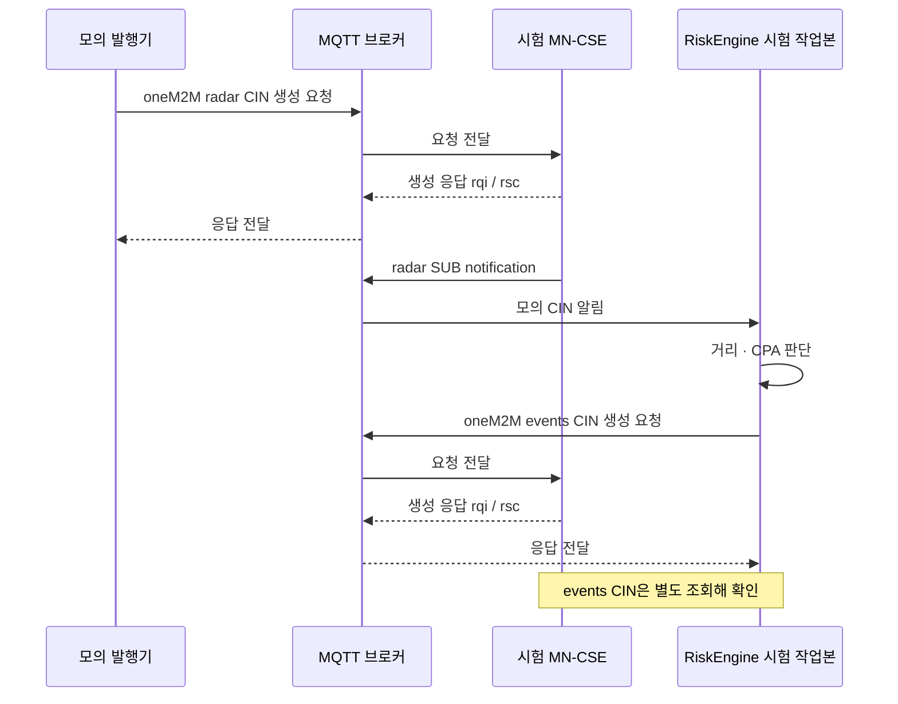
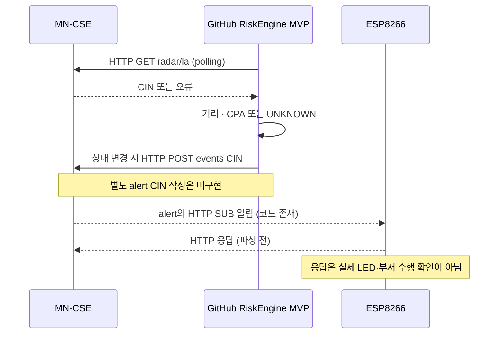

# SafeZone 아키텍처와 통합 상태

## 문서 범위

2026-11-12까지 공유된 팀 정보, GitHub 코드와 별도 시험 결과를 정리한다. **현재 프로토타입**, **코드·모의 시험**, **미검증 목표**는 서로 다르다. 각 시험의 서버·DB와 데이터 출처를 확인하고, 단일 시험 결과로 실제 장비 전체 연동이나 산업안전 성능을 주장하지 않는다.

- 저장소 기준: 기존 RiskEngine MVP와 Vision 코드; MQTT 수신·발행 엔진 시험은 별도 작업본이며 `main`에 반영되지 않았다.
- 현태의 설명: LD2450은 Pi UART에 직접 연결되어 있으며 ESP8266은 레이더와 직접 연결하지 않고 tinyIoT의 HTTP 알림을 받는다. 장비별 현재 펌웨어·동작은 재확인이 필요하다.
- 광민의 보고: Pi MN과 노트북 IN의 연결 시험 성공. 다른 시험에서는 Pi 내부 IN도 사용했다. CSE 등록과 `events`의 IN 전달은 별도 검증이다.
- [Vision PR #9](https://github.com/extra-7ex/Sejong_4IoT_OneM2M/pull/9): 실제 radar CIN 예시를 Vision이 읽었고, MQTT·HTTP 입력/출력과 녹화 영상으로 시험했다고 보고했다. PR은 작성 당시 열린 상태였으며 해당 보고의 전체 재현 여부는 별도 기록한다.

## 현재 프로토타입과 목표

### 현재 확인된 배치



점선은 특정 코드·시험 환경·목표 중 하나에 한정되며, 실제 전체 통합을 의미하지 않는다. `radar`, `events`, `fusedTracks`, `alert`는 MN-CSE 아래 CNT다. 현재 확인된 레이더 배선은 **LD2450 → Pi UART**다. ESP8266이 직접 radar를 읽는 구성은 과거 목표안이며 현재 배선으로 단정하지 않는다.

### 향후 목표 경로



RiskEngine과 MN 사이에 MQTT를 사용하는 방향을 목표로 한다. 현재 GitHub 엔진의 기본 입력·이벤트 출력은 HTTP다. 별도 MQTT 시험 작업본은 아래 시험 결과를 참고한다. 경보·장비 제어 및 네트워크 장애 시 동작은 설계·검증 대상이다.

### MQTT 통합 시험의 흐름

이 흐름은 실제 장비가 아닌 **별도 시험 CSE·CNT와 모의 radar CIN**으로 확인했다. SUB 생성 전 MQTT 수신기가 시험 토픽을 구독했으며, CSE는 시험 브로커를 이용했다.



시험에는 RiskEngine MQTT 입력·출력 작업본, 별도 CSE ID·포트·DB 및 실험용 리소스를 사용했다. 사용한 tinyIoT는 SUB 검증 알림에 수신 애플리케이션 응답이 없는데도 SUB를 생성했다. **검증 응답 구현과 다른 tinyIoT 버전의 호환성은 미확인**이다.

### 현재 HTTP 입력과 장치 경로



## 리소스와 책임

```text
<TinyIoT-MN>                              # 팀 제안; 실제 서비스별 응답 확인
├─ AE-forklift01 (Cforklift01)
│  ├─ radar       [CNT]                   # radar CIN
│  └─ alert       [CNT]                   # 장치용 경고; 작성 주체·정책 확인
├─ AE-riskengine (Criskengine)
│  └─ events      [CNT]                   # 위험 판단 이력
├─ AE-VisionAI (CVisionAI)
│  └─ fusedTracks [CNT]                   # Vision 융합 결과
├─ AE-zonealarm01
│  └─ alert       [CNT]                   # 목표·실제 연결 미검증
└─ AE-camera01
   └─ detect      [CNT]                   # 기존 구상; Vision 경로와 역할 확인
```

`radar`에는 대상이 최대 3개인 CIN을 저장한다. 별도의 `events`와 `alert`를 사용하는 방향을 논의했으나, 기존 RiskEngine MVP는 `events`를 작성하고 별도 `alert`는 작성하지 않는다. Pi 레이더 업로더의 한 확인본에는 `LOCAL_DECISION=True`로 `alert`를 작성하는 임시 코드가 있었다. 실제 실행 버전과 작성 주체 전환은 현태·엔진 담당자가 확인한다.

Vision은 `AE-VisionAI/fusedTracks`에 결과를 기록하는 코드가 있다. RiskEngine이 Vision을 위험 등급에 반영하는 규칙은 미결정이며, 별도 작업본의 fusedTracks polling은 관찰용이다. Vision의 `ghost_suspect`를 사람 부재의 확정으로 취급하지 않는다.

## 통신과 시험 결과

| 구간 | 확인된 내용 | 남은 확인 |
|---|---|---|
| LD2450 → Pi | UART 직접 연결은 현태의 설명. 실제 현장 전체 연결 시험으로 확대 해석하지 않는다. | 실제 배선·작동 중 업로더 버전·CIN 연속 기록 |
| radar → MN | MQTT 요청으로 CIN을 만들고 HTTP로 조회한 Pi 시험을 광민이 보고했다. 실제 ESP MQTT 발행은 미시험. | 실제 업로더의 전송 방식과 응답·빈 프레임·전송 주기 |
| radar → RiskEngine → events | 모의 CIN, 독립 MN에서 HTTP polling 및 events 생성·조회 확인. | 실제 radar·현재 팀 MN에서 재시험; 시작 시 오래된 la 처리 |
| MQTT notification → RiskEngine → events | 별도 시험 서버에서 SUB 검증 알림과 CIN 알림을 수신하고, 모의 CIN → MQTT notification → 위험 판단 → MQTT events 요청·rqi/rsc 및 CIN 조회를 확인했다. | 별도 엔진 작업본이며 `main` 미반영. 실제 MN·센서, 알림 검증 응답과 접근 권한을 확인한다. |
| Vision | PR #9가 녹화 영상 기반 Vision 실행, 실제 radar CIN 예시 해석 및 MQTT/HTTP 접근 시험을 보고했다. RiskEngine 측은 모의 fusedTracks를 별도 시험 CNT에서 polling해 관찰했다. | C270 실시간 출력 → 실제 fusedTracks → RiskEngine 조회; 스키마·표적 연관·조언 반영 |
| MN ↔ IN | Pi MN과 노트북 IN의 CSE 연결 성공이 보고됐다. 별도 Pi 내부 IN 시험도 보고됐다. | 어떤 서버·이름·ID인지와 등록, 원격 조회, 실제 `events` 전달을 각각 검증 |
| alert → ESP | HTTP `/notify` 수신 코드와 구독 생성 스크립트가 있다. | 현재 장치·SUB/nu·실제 CIN 수신·LED/부저/모터 동작. 엔진 alert 발행은 별도 작업 |

상희의 MQTT 시험 보고는 RAM에 둔 DB 복사본에서 330건 중 325건의 생성 성공 응답을 확인했다. 5건의 실패 또는 응답 누락 원인은 미확인이다. 같은 보고의 SD카드 DB 약 1.6초/건은 별도 환경의 관찰이며 일반적인 지연 또는 성능 보장값이 아니다. 1초 데이터 만료 기준과 실제 CIN 수신 간격은 재측정이 필요하다.

## 좌표·시간과 위험 판단

- radar CIN의 x·y는 mm, v는 cm/s라는 코드·시험 가정이 있다. `slot`을 포함하는 실제 CIN 예시가 보고됐지만, 다중 표적 교차·가림·소실 시 슬롯 유지와 재사용은 미검증이다.
- Vision의 fusedTracks x·y·`dist_m`은 m, `ttc_s`는 초라는 현재 코드 가정이다. 실제 설치 시 센서의 원점·축 방향·보정과 시간 기준을 확인한다.
- RiskEngine은 현재 거리와 같은 표적으로 연결한 연속 좌표의 변화로 상대속도·2D CPA를 계산한다. `t_cpa`는 최근접 시각이지 위험 반경에 처음 들어가는 시각이 아니며, 현재 속도 유지 조건의 예측이다. Vision의 거리/접근속도 `ttc_s`와 동일시하지 않는다.
- 위험 반경·거리·시간 임계값은 시험 가설이다. 센서 오차, 회전하는 레이더 좌표계, 센서 설치 오프셋 및 지게차 실제 크기는 추가 검토가 필요하다.
- 기존 GitHub MVP는 시작 시 오래된 `radar/la`를 새 입력으로 받아들일 수 있다. 별도 엔진 작업본은 첫 CIN을 기준점으로 기억하고 다음 CIN을 기다린다. 실제 업로더가 표적이 없을 때 빈 CIN을 보내지 않으면 UNKNOWN이 지속될 수 있다. 실제 전송 여부와 정책을 확인한다.

## 실패와 장애 처리

| 상황 | 현재 확인 및 미결 사항 |
|---|---|
| 입력 누락·오래된 CIN | 엔진의 기존 stale 정책은 UNKNOWN이다. 최근 별도 작업본의 최초 CIN 보류 정책은 실제 장비 미검증. |
| MN → IN 연결 실패 | 기존 MN 코드에는 시작 시 IN 등록 실패로 부팅이 중단되는 경로가 있다. IN 장애 중 MEC 로컬 기능 유지와 재연결은 팀 논의 중이다. 독립 시험에서는 등록을 생략했으므로 이 정책을 검증하지 않았다. |
| 통지 확인·재전송 | MQTT 시험 tinyIoT는 직접 `m2m:sgn` 형태의 검증 알림을 발행했고 별도 수신 응답 없이 SUB를 생성했다. 표준적인 검증 응답 처리, 중복·유실·재연결은 추가 검증이 필요하다. |
| 이벤트 저장 지연·timeout | 응답 timeout 뒤에도 CIN이 생성된 사례가 있다. 중복 방지와 저장 여부 확인, 재처리 정책이 필요하다. |
| RiskEngine·Pi·Wi-Fi 장애 | 엔진이 멈추면 UNKNOWN을 전송할 수 없다. 장치 측 무신호 동작, 별도 인터락, 통신 복구 및 재가동은 미확정이다. |

`LOCAL_DECISION`은 레이더 노드의 임시 alert 작성 로직이며, 네트워크에 의존하지 않는 직접 모터 정지 인터락의 구현·검증 근거가 아니다. 기존 ESP 펌웨어의 `warn`/`danger` 이외 표시 및 부팅 시 LED 동작도 합의된 안전 정책이 아니다.

## 우선 확인할 인터페이스

1. 현태·태양: 실제 UART 업로더의 코드 버전, CIN `slot`·좌표·속도·timestamp, 빈 프레임 전송 주기, alert 작성 주체 확인.
2. 광민·태양: 실제 서비스의 CSEBase `rn`/`ri`/`csi`, 서버·DB, MQTT 토픽·oneM2M 응답·ACP, IN 등록과 이력 전달 분리 검증.
3. 상희·태양: 실제 fusedTracks CIN의 단위·원점·축·ID·신선도 및 판정 반영 여부 확인. slot이 없을 때 Vision과 엔진의 대체 ID 규칙은 현재 차이가 있다.
4. 팀 공통: UNKNOWN, 장치 경고, 연결 장애·복구, 로컬 인터락과 재가동의 기준을 결정하고 실제 장비에서 검증.

## 근거와 기록

- [프로젝트 README](../README.md): 기존 구상, 현재 UART 배선 표와 목표 배선.
- [RiskEngine README](../engine/README.md) 및 [RiskEngine 코드](../engine/risk_engine.py): 현재 저장소 MVP의 거리·CPA와 전제.
- [Vision 코드](../vision/src/vision4iot/main.py), [Vision 설계](../vision/CLAUDE.md), [Vision PR #9](https://github.com/extra-7ex/Sejong_4IoT_OneM2M/pull/9): Vision 입출력과 시험 보고.
- [CSE 명명안](cse-naming.md): 제안 이름과 전환 시 고려사항.
- [이슈 #7](https://github.com/extra-7ex/Sejong_4IoT_OneM2M/issues/7), [이슈 #8](https://github.com/extra-7ex/Sejong_4IoT_OneM2M/issues/8): 독립 MN 및 Vision 모의 연동 기록. 각 이슈의 시점과 환경에 한정한다.
- 현태·광민의 배선 및 서버 시험 설명은 팀 전달 내용이다. 코드 존재, 담당자 보고와 독립적인 실장비 재현 결과를 구별한다.
