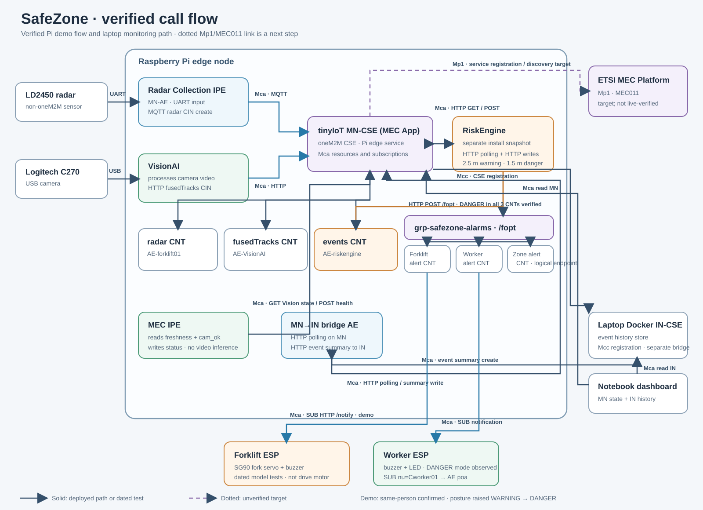

# Hackster submission working copy

## Basics tab — separate fields, not part of Story

**Short title**

SafeZone: Camera–Radar Fusion for Forklift Safety

**Elevator pitch**

Radar and camera risk checks drive oneM2M alerts, worker warnings, and a servo stop on a scale forklift model.

## Story field — paste only the sections below

### The problem

Forklift operators have blind spots around the vehicle, while workers may not be wearing a tag. SafeZone uses radar to detect people without depending on a wearable tag, then combines that input with camera-based Vision results to assess risk. A separate worker tag adds a direct warning channel for the person.

### What SafeZone does

SafeZone is an edge IoT prototype built around a Raspberry Pi and a 3D-printed forklift model. Its LD2450 radar monitors the rear blind spot. VisionAI processes a Logitech C270 camera, and the RiskEngine turns the available sensor data into SAFE, WARNING, DANGER, or UNKNOWN states. oneM2M stores the inputs and event history and routes alert state to the model’s alarm node and worker tag.

On the scale model, the forklift alarm node drives an SG90 servo and buzzer: WARNING keeps the fork moving with a slower beep, while DANGER stops the fork and sounds a faster alarm. The worker tag has its own buzzer and LED. These are model and wearable-node behaviors; SafeZone has not been validated as a safety system for a full-size forklift.

### Architecture and data flow

The LD2450 sends frames to the Pi’s radar collection IPE/MN-AE over UART. The uploader creates radar CINs in the tinyIoT MN-CSE using MQTT. A Logitech C270 connects to VisionAI over USB; VisionAI publishes `fusedTracks` CINs to the CSE over HTTP. The RiskEngine retrieves the latest radar and configured Vision CINs over HTTP polling, evaluates risk, and writes event CINs plus alert state over HTTP.

The alarm group `grp-safezone-alarms` contains forklift, worker, and zone alert containers. A write to the group’s `/fopt` fan-out was verified to record DANGER in all three alert containers. SUB resources define the notification routes: the worker subscription addresses `Cworker01`, which the CSE resolves through the worker AE’s point of access; the forklift subscription stores an HTTP `/notify` URL. Both ESPs use the oneM2M Mca path for their subscriptions and notifications. The worker tag registers as `AE-worker01` and carries the discovery label `type:worker-alarm`.

The Pi also runs a bridge AE that polls event data from its MN-CSE and writes summaries to an IN-CSE. In the 20 November deployment check, that IN-CSE was Docker on a laptop; a separate local IN-CSE service also runs on the Pi but was not the bridge target. The dashboard reads current state from MN and event history from IN. The bridge makes HTTP/Mca requests to each CSE; it is not a direct CSE-to-CSE Mcc exchange.

### How we use oneM2M

AE, CNT, and CIN resources separate the radar, Vision, RiskEngine, and device applications while giving them a shared data model. Radar CIN creation used the oneM2M MQTT binding on the Pi check; Vision writes, RiskEngine reads and writes, ESP notifications, and the MN-to-IN bridge used HTTP over their Mca paths. The bridge does not implement a direct Mcc link between the MN-CSE and IN-CSE. We also inspected the worker ACP: `CAdmin` has create, retrieve, and discovery permissions (mask 35), so least-privilege review remains open.

GRP provides fan-out to multiple alert containers, SUB defines notification destinations, ACP resources define access rights, and the worker AE label supports discovery. During integration, re-registering the worker AE created a new alert-container resource ID and left the group pointing at the old member. We restored the group membership using the current resource ID, then verified DANGER in all three alert containers and the worker ESP entering risk mode.

### Edge processing and MEC

The Pi hosts the sensor-facing services and RiskEngine near the forklift model. A service-health IPE reads Vision freshness and `cam_ok` and writes a health resource into oneM2M. This gives the operator context when camera output is missing or stale; the IPE does not make the risk decision.

The deployed MEC-related function is a service-health IPE on the Pi. It reads Vision output freshness and `cam_ok`, then reports health to oneM2M; it does not carry camera frames or run Vision inference. We have not verified a live ETSI MEC011 platform performing service registration and discovery for the Vision or radar apps, and we have not measured a MEC latency improvement.

### Hardware build

The model places the LD2450 behind a rear window to watch the blind spot. Its forklift alarm node uses a NodeMCU ESP8266 on an HW-389 base board, a 9 V battery, an SG90 servo that moves the model fork, and a buzzer. This is a fork actuator on the scale model, not the forklift’s drive motor. The node receives oneM2M HTTP notifications from the MN-CSE; it does not communicate directly with the radar.

The worker tag uses a second NodeMCU in a 3D-printed wearable case with a buzzer and an LED window. On boot, its firmware registers an AE with ACP, alert and status containers, and a subscription. The `type:worker-alarm` label lets the service discover worker tags. The firmware publishes a 30-second heartbeat. The camera is a Logitech C270; the Pi uses a 5 V, 3 A supply. Portable tests also used a USB power bank.

### Software

The stack uses Python for the radar uploader, RiskEngine, VisionAI, bridge, service-health IPE, and dashboard. VisionAI uses Ultralytics YOLO pose inference and OpenCV. tinyIoT provides the MN-CSE and IN-CSE; Docker runs the laptop IN-CSE. The radar uploader and RiskEngine use different oneM2M bindings, so the full path is not described as MQTT end to end.

### Demo and results across test iterations

These results came from separate dated test runs and settings; the values are not one combined configuration.

- **15 November:** A team test sent radar frames, including empty frames, at about 0.5-second intervals. In that HTTP alert run, alert creation plus notification was recorded at 0.00–0.12 seconds, and the model fork stop and buzzer were observed. This is a short-run measurement, not a latency guarantee.
- **16 November:** The worker-tag test covered automatic AE registration, `type:worker-alarm` label discovery, and RiskEngine alert logging.
- **18 November:** The model alarm test used WARNING at 1.0 m and DANGER at 0.5 m. The reported behavior was slow warning beeps while the fork kept moving, then a stopped fork and faster buzzer in DANGER.
- **19 November:** The team rebuilt registrations and subscriptions over a phone hotspot. The Pi and two ESP nodes registered, but the final end-to-end alarm result from that outdoor run was not recorded in the notes provided.
- **20 November Pi check:** The active RiskEngine used WARNING at 2.5 m, DANGER at 1.5 m, and five-second stale/association settings. The current radar uploader used MQTT; its log showed about 0.30–0.33-second responses at roughly 0.53-second intervals. These MQTT figures and the earlier HTTP measurement came from different test runs and are not a direct performance comparison. DANGER was written to all three alert containers, and the worker ESP entered risk mode.

In a Vision test after the equipment was restored, the Pi recognized the C270 and VisionAI, started from the `/home/user/vision4iot` environment, created a fresh `fusedTracks` CIN, and the RiskEngine read it as fresh. The `tracks` list was empty in that run, so it verified camera availability and the fresh-data path, not a positive person detection. An earlier read-only snapshot had found the Vision output stale before this manual run. Continuous service operation was not verified. The recorded demo separately showed camera–radar risk assessment.

### Lessons learned

HTTP and MQTT are both useful oneM2M bindings, but results depend on the CSE and notification path. An early HTTP test recorded short response times; on the later Pi MQTT path, the uploader waits for the CSE response and skips frames while a request is pending, preventing a backlog of old radar frames. In an earlier Pi check, unreachable HTTP notification endpoints coincided with alert-group response timeouts; the exact timeout cause was not isolated, so endpoint reachability is checked as part of the call path.

Worker registration and group membership are separate resources. When the worker AE is recreated, its alert CNT RI can change; the GRP `mid` list must be updated to the current RI. Checking the AE, ACP, SUB, alert CNT, group membership, and physical notification together made this failure visible.

### Limitations and next steps

The thresholds and five-second settings are team-selected demo values, not validated safety limits or tracking guarantees. The most recent fresh Vision input contained no detected people, and continuous Vision operation was not confirmed. The phone-hotspot test’s final alarm outcome, restart recovery, long-duration reliability, and full-size forklift performance remain unverified. The model demonstrates an automatic servo stop; it is not a certified vehicle interlock.

### Team roles

The team split work across radar and forklift alarm hardware, worker-tag firmware and oneM2M registration, VisionAI and camera calibration, and Pi-side RiskEngine, CSE integration, bridge, dashboard, and MEC health reporting.

## Submission assets — outside the Story field

- Embed the recorded demo video in the separate video field.
- Choose a cover image for the separate 4:3 image field.
- Add the architecture illustration shown above to the Story. It is a call-flow diagram, not an electrical schematic.
- Upload the actual circuit schematic as PDF or PNG. No circuit schematic file was present in the project files I reviewed; an architecture diagram is not a substitute.
- The existing Story values describe dated test iterations. Before submission, match the video’s date to its threshold and deployment profile so the video, Story, and form fields identify the same run.
