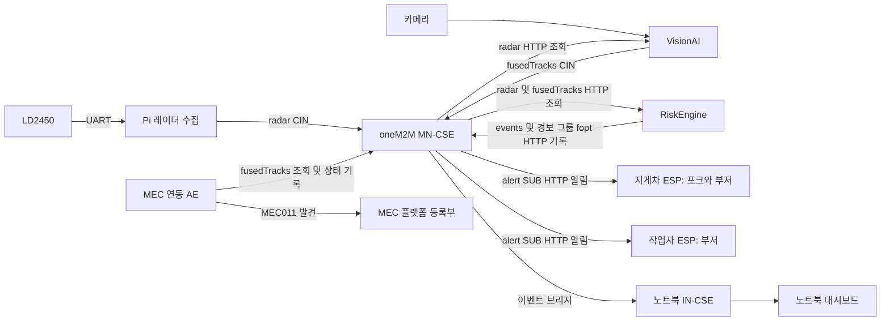

# Pi 실장비 구성과 시험 기록

2026-11-20 확인 기준이다. IP 주소는 DHCP로 달라질 수 있다. 이 기록은 산업용 안전 성능을 보증하지 않는다.

## 현재 흐름

엔진이 경보 판단 주체이며 레이더의 LOCAL_DECISION은 비활성이다. 엔진과 CSE 사이는 현재 HTTP polling과 HTTP 기록이다. 경보 그룹에는 지게차·작업자·구역 alert CNT 세 개가 있다. MN→IN 이벤트 브리지는 별도 애플리케이션이므로 브리지 데이터 전달 자체를 Mcc로 단정하지 않는다. 최근 ACP 변경 후 세 CNT에 danger 기록을 확인했으며, 그 변경 후 ESP 알림 수신과 기기 동작은 별도 확인이 필요하다.

## 엔진 및 ACP

- 실행 경로는 `/opt/safezone/engine-freshness-20261119`, Origin은 `Criskengine`이다. radar 및 fusedTracks를 읽고 events와 `grp-safezone-alarms/fopt`에 기록한다.
- 시연 설정은 `RISK_STALE_AFTER_S=5`, `RISK_MAX_SAMPLE_INTERVAL_S=5`, 위험 거리 1.5m, 경고 거리 2.5m다. 원래 설계 기준은 stale 1초, 표본 간격 0.75초이며 시연 설정은 지연 상황에서 UNKNOWN을 늦출 수 있다. 값은 산업안전 임계값이 아니다.
- 레이더 업로더의 별도 LOCAL_DECISION 임계값은 위험 1.5m, 경고 3m다. 현재 LOCAL_DECISION은 꺼져 있어 위 엔진 값이 적용된다. 다시 켜면 판단 주체와 경고 거리 차이를 먼저 확인한다.
- 운영 그룹의 멤버는 세 개이며 `cnm=3`이다. 그룹 `macp`와 세 alert CNT ACP는 Criskengine에 CREATE를 허용한다. 소유자 권한과 작업자 CNT의 기존 CAdmin 권한은 유지했다. 무구독 시험 그룹에서 fan-out CREATE를 검증했고, 운영 전환 후 events의 HTTP 201/RSC 2001 및 세 CNT의 danger CIN을 확인했다.
- 복구본: `/etc/default/safezone.codex-backup-20261120`, `/etc/systemd/system/safezone-engine.service.codex-backup-20261120`. 적용 전 현재 drop-in과 설정을 확인한다. radar·fusedTracks MQTT SUB는 이번 전환에서 만들지 않았다.

## MEC 및 Vision

- Pi의 IPE는 `/opt/safezone/mec-discovery/mec_ipe.py`를 사용하며 systemd drop-in `/etc/systemd/system/safezone-ipe.service.d/50-mec-discovery.conf`에서 MEC011 발견을 활성화했다. 등록부 주소는 로컬 18080, 서비스명은 수동 등록한 `safezone-vision-cin-trial`이다.
- 등록된 주소는 실제 MN-CSE의 `AE-VisionAI/fusedTracks/la`다. 11월 20일 실제 VisionAI를 실행하자 IPE가 최신 CIN을 읽고 INACTIVE에서 ACTIVE로 바뀌었다. 약 2.1 FPS로 실행 중 2초 기준을 넘겨 INACTIVE와 ACTIVE 사이가 한 차례 흔들렸다. 시험 후 Vision을 종료했고 다시 INACTIVE가 됐다.
- MEC 등록부의 ACTIVE는 실제 Vision 데이터가 최신임을 보장하지 않는다. Vision 자동 서비스 등록, 다중 서비스 선택, 원격 장비 발견과 장시간 안정성은 미검증이다. 엔진은 IPE 상태 CIN을 소비하지 않는다.
- `IPE_MEC_BASE`는 등록부 주소, `IPE_DISCOVERY_CSE_BASE`는 허용할 데이터 CSE 주소다. 후자가 없으면 `IPE_MN_BASE`를 사용한다. CSE 주소 변경 시 설정도 갱신해야 한다.

## 네트워크 복구

Pi와 ESP의 IP는 DHCP로 바뀔 수 있으므로 재시작 후 현재 주소를 확인한다. 지게차 ESP의 펌웨어 CSE 주소, MN의 alert SUB 알림 주소, 작업자 AE의 등록 주소와 SUB, 노트북 IN-CSE 및 브리지 설정을 현재 주소와 대조한다. 연결 주소를 바꾸기 전 기존 설정과 리소스를 확인하고, 실제 알림과 대시보드 반영까지 시험한다. DHCP 예약은 운영 환경의 선택 사항이다.
